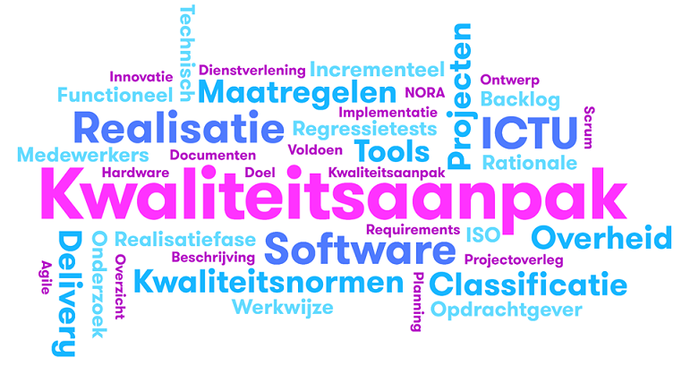
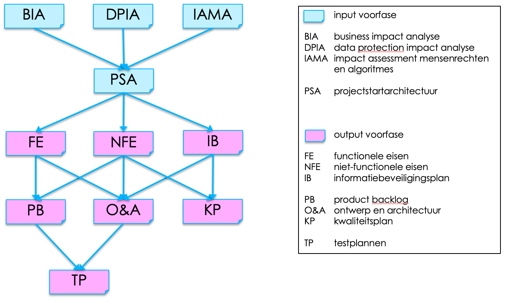

ICTU Kwaliteitsaanpak Softwareontwikkeling

Versie v5.4.1, 28-09-2026

# Inhoudsopgave

- [Inleiding](#inleiding)
- [Doelstellingen en uitgangspunten](#doelstellingen-en-uitgangspunten)
- [Leeswijzer](#leeswijzer)
  - [Doelgroep](#doelgroep)
  - [Maatregelen](#maatregelen)
  - [Rollen](#rollen)
  - [Ondersteuning](#ondersteuning)
  - [Versionering](#versionering)
  - [Terminologie](#terminologie)
- [Producten](#producten)
  - [M01: Het project ontvangt en levert in elke fase vastgestelde producten en informatie](#m01-het-project-ontvangt-en-levert-in-elke-fase-vastgestelde-producten-en-informatie)
  - [M32: Het project onderzoekt de kwaliteit van over te nemen software](#m32-het-project-onderzoekt-de-kwaliteit-van-over-te-nemen-software)
  - [M02: Het project bewaakt continu dat het product aan de kwaliteitsnormen voldoet](#m02-het-project-bewaakt-continu-dat-het-product-aan-de-kwaliteitsnormen-voldoet)
  - [M03: Het project zorgt dat het product traceerbaar aan eisen voldoet](#m03-het-project-zorgt-dat-het-product-traceerbaar-aan-eisen-voldoet)
  - [M04: Het project borgt de correcte werking van het product met geautomatiseerde regressietests](#m04-het-project-borgt-de-correcte-werking-van-het-product-met-geautomatiseerde-regressietests)
  - [M07: Het project gebruikt een continuous delivery pipeline om het product te bouwen, testen en op te leveren](#m07-het-project-gebruikt-een-continuous-delivery-pipeline-om-het-product-te-bouwen-testen-en-op-te-leveren)
  - [M16: Het project gebruikt tools voor vastgestelde taken](#m16-het-project-gebruikt-tools-voor-vastgestelde-taken)
  - [M08: Het project maakt technische schuld inzichtelijk en lost deze planmatig op](#m08-het-project-maakt-technische-schuld-inzichtelijk-en-lost-deze-planmatig-op)
  - [M26: Het project laat de beveiliging van het ontwikkelde product periodiek beoordelen](#m26-het-project-laat-de-beveiliging-van-het-ontwikkelde-product-periodiek-beoordelen)
- [Processen](#processen)
  - [M14: Het project bereidt samen met opdrachtgevende organisatie en betrokken partijen de realisatie voor](#m14-het-project-bereidt-samen-met-opdrachtgevende-organisatie-en-betrokken-partijen-de-realisatie-voor)
  - [M21: Het project selecteert medewerkers op basis van kwaliteit](#m21-het-project-selecteert-medewerkers-op-basis-van-kwaliteit)
  - [M23: Het project zorgt voor de aanwezigheid van kennis van en ervaring met de Kwaliteitsaanpak](#m23-het-project-zorgt-voor-de-aanwezigheid-van-kennis-van-en-ervaring-met-de-kwaliteitsaanpak)
  - [M05: Het project hanteert een iteratief en incrementeel ontwikkelproces](#m05-het-project-hanteert-een-iteratief-en-incrementeel-ontwikkelproces)
  - [M35: Het project hanteert een agile architectuuraanpak](#m35-het-project-hanteert-een-agile-architectuuraanpak)
  - [M10: Het project kent een wekelijks projectoverleg](#m10-het-project-kent-een-wekelijks-projectoverleg)
  - [M28: Het project voert periodiek een self-assessment uit tegen de actuele versie van de Kwaliteitsaanpak](#m28-het-project-voert-periodiek-een-self-assessment-uit-tegen-de-actuele-versie-van-de-kwaliteitsaanpak)
  - [M30: Het project identificeert, mitigeert en bewaakt risico's](#m30-het-project-identificeert-mitigeert-en-bewaakt-risicos)
  - [M34: Het project draagt software beheerst over](#m34-het-project-draagt-software-beheerst-over)
  - [M27: Het project sluit projectfasen en zichzelf expliciet af](#m27-het-project-sluit-projectfasen-en-zichzelf-expliciet-af)
- [Organisatie](#organisatie)
  - [M29: ICTU organiseert voor aanvang van een project de interne dienstverlening](#m29-ictu-organiseert-voor-aanvang-van-een-project-de-interne-dienstverlening)
  - [M19: ICTU biedt projecten een afgeschermde digitale omgeving](#m19-ictu-biedt-projecten-een-afgeschermde-digitale-omgeving)
  - [M18: ICTU biedt ondersteuning voor verplicht gestelde tools](#m18-ictu-biedt-ondersteuning-voor-verplicht-gestelde-tools)
  - [M11: ICTU beheert, onderhoudt en implementeert de Kwaliteitsaanpak en kwaliteitsnormen](#m11-ictu-beheert-onderhoudt-en-implementeert-de-kwaliteitsaanpak-en-kwaliteitsnormen)
  - [M12: ICTU publiceert nieuwe versies van de Kwaliteitsaanpak en normen periodiek en op een vaste locatie](#m12-ictu-publiceert-nieuwe-versies-van-de-kwaliteitsaanpak-en-normen-periodiek-en-op-een-vaste-locatie)
  - [M33: ICTU organiseert periodiek een gezamenlijke self-assessment ten aanzien van de Kwaliteitsaanpak](#m33-ictu-organiseert-periodiek-een-gezamenlijke-self-assessment-ten-aanzien-van-de-kwaliteitsaanpak)
- [Bijlagen](#bijlagen)
  - [Terminologie en afkortingen](#terminologie-en-afkortingen)
  - [Bronnen](#bronnen)
  - [Overzicht maatregelen](#overzicht-maatregelen)
  - [Relatie met NEN NPR 5326](#relatie-met-nen-npr-5326)

# Inleiding

De overheid is in hoge mate afhankelijk van informatiesystemen voor de uitvoering van haar taken. Veel van die informatiesystemen zijn dusdanig specifiek dat de benodigde software “op maat” gemaakt moet worden. De totstandkoming van op maat gemaakte software is meestal een complex proces, waarin vele belangen en behoeften worden afgewogen en afgezet tegen de mogelijkheden die technologie biedt. Eenmaal operationeel zal een informatiesysteem verantwoord onderhouden moeten worden; behoeften en technologie veranderen in de loop van de tijd.

Overheidsprojecten, waarin software wordt ontwikkeld of onderhouden, kampen nog vaak met vertraging, budgetoverschrijding of een eindresultaat met te lage kwaliteit. Zo concludeerde de commissie-Elias in haar [eindrapport](https://www.tweedekamer.nl/sites/default/files/field_uploads/33326-5-Eindrapport_tcm181-239826.pdf): "De Rijksoverheid heeft haar ICT (Informatie- en communicatietechnologie)-projecten niet onder controle". Een van de fundamentele problemen is dat de risico's, die inherent zijn aan softwareontwikkeling, door organisaties nog onvoldoende worden herkend, erkend en gemitigeerd. Dit terwijl de risico's bij de ontwikkeling van software, binnen het ICT-domein, algemeen bekend zijn en er ook voor veel risico's passende maatregelen bestaan.

ICTU heeft jarenlange ervaring met het realiseren van software en past de opgedane ervaring toe bij de ontwikkeling van nieuwe software. Die ervaring is vastgelegd in een werkwijze, deze “ICTU Kwaliteitsaanpak Softwareontwikkeling”, die telkens wordt aangepast en aangevuld op basis van de praktijk.

ICTU is ervan overtuigd dat het bouwen van duurzame software, die goed aansluit bij de behoeften van gebruikers en andere belanghebbenden, bijdraagt aan betere informatiesystemen en een betere dienstverlening door de overheid. Dienstverlening die betrouwbaar moet zijn voor burgers, bedrijven en ambtenaren. Om samen met opdrachtgevende organisaties passende oplossingen te realiseren, ontwikkelt ICTU software volgens een agile proces. En om de duurzaamheid en betrouwbaarheid te bevorderen, besteedt ICTU standaard aandacht aan beveiliging, privacy, performance, gebruikskwaliteit en toegankelijkheid. De Kwaliteitsaanpak dient daarvoor als leidraad, maar de aanpak voorziet ook in mogelijkheden om het project en het eindproduct aan te passen aan de specifieke situatie.

Om projecten, die software realiseren volgens de Kwaliteitsaanpak, efficiënt en effectief te ondersteunen, heeft ICTU twee gespecialiseerde afdelingen in het leven geroepen. Deze afdelingen staan projecten bij door middel van kennis, menskracht en technische hulpmiddelen. Zo profiteren projecten van schaalgrootte en hergebruik van inzichten.

Met behulp van de ICTU Kwaliteitsaanpak Softwareontwikkeling heeft ICTU samen met andere overheden inmiddels enige tientallen projecten succesvol uitgevoerd. ICTU wil deze aanpak graag aanvullen met de ervaringen en geleerde lessen van andere organisaties en deze overdraagbaar maken en breder uitdragen. Om die reden stelt ICTU deze Kwaliteitsaanpak aan iedereen beschikbaar via <https://www.ictu.nl/kwaliteitsaanpak> en heeft zij, samen met normalisatie-instituut NEN en partijen uit overheid en markt, een praktijkrichtlijn “Risicobeheersing bij ontwikkeling en onderhoud van maatwerksoftware” \[NEN NPR 5326:2019\] gepubliceerd, die mede is gebaseerd op de ICTU Kwaliteitsaanpak Softwareontwikkeling.

# Doelstellingen en uitgangspunten

De ICTU Kwaliteitsaanpak Softwareontwikkeling heeft drie doelstellingen:

1.  Opdrachtgevende organisaties helpen bekende risico's bij softwareontwikkeling, zoals technische schuld, vertraging en defecten, zo veel mogelijk te voorkomen.

2.  ICTU helpen om software te ontwikkelen die de missie van ICTU, namelijk bijdragen aan een betere digitale overheid, ondersteunt.

3.  De overheid als geheel helpen bij het zo goed mogelijk ontwikkelen van software.

De Kwaliteitsaanpak zelf is geformuleerd in de vorm van maatregelen die elke software-ontwikkelende organisatie kan treffen om risico's van softwareontwikkeling te mitigeren en de kans op succesvolle softwareontwikkelprojecten te vergroten. De maatregelen zijn gebaseerd op geleerde lessen uit de praktijk van ICTU.

De Kwaliteitsaanpak is een evoluerende aanpak, gebaseerd op de ervaringen die ICTU continu opdoet in de projecten waarin ICTU samen met opdrachtgevende organisaties maatwerksoftware ontwikkelt en onderhoudt. ICTU hanteert daarbij de vuistregel dat als tenminste 80% van de projecten minstens 80% van de tijd een bepaalde werkwijze hanteert, voor die werkwijze een maatregel in de Kwaliteitsaanpak wordt opgenomen. Maar het kan ook voorkomen dat maatregelen om andere redenen landen in de Kwaliteitsaanpak; denk aan het toegankelijk maken van software, wat wettelijk verplicht is. Zie ook de [wijzigingsgeschiedenis](https://ictu.github.io/Kwaliteitsaanpak/v5.4.1/ICTU-Kwaliteitsaanpak-Wijzigingsgeschiedenis.html).

De maatregelen vormen het startpunt voor de aanpak van ieder ICTU-softwareproject, waarbij ruimte wordt geboden voor variatie of alternatieve invulling. Bijvoorbeeld stelt de Kwaliteitsaanpak: software wordt minimaal bij iedere grote release of tenminste twee keer per jaar onderworpen aan een beveiligingstest door beveiligingsexperts die ICTU daarvoor inhuurt (zie [M26: Het project laat de beveiliging van het ontwikkelde product periodiek beoordelen](#m26-het-project-laat-de-beveiliging-van-het-ontwikkelde-product-periodiek-beoordelen)). Een alternatief is dat de opdrachtgevende organisatie de verantwoordelijkheid neemt voor het laten uitvoeren van beveiligingstests. Hierover maakt de projectleider nadere afspraken met de opdrachtgever.

De Kwaliteitsaanpak is dus zowel voorschrijvend als beschrijvend. Voorschrijvend omdat ICTU verwacht dat projecten die maatwerksoftware ontwikkelen en onderhouden de aanpak toepassen, en alleen aanpassen als daar een goede reden voor is, en mits dat wettelijk is toegestaan. Tegelijkertijd is de aanpak beschrijvend omdat de meeste maatregelen voortkomen uit de bestaande werkwijzen van de projecten. Zoals blijkt uit de self-assessment die ICTU regelmatig uitvoert op de toepassing van de Kwaliteitsaanpak.

# Leeswijzer

## Doelgroep

Dit document "ICTU Kwaliteitsaanpak Softwareontwikkeling", verder ook aangeduid met 'de Kwaliteitsaanpak', is bedoeld voor software en gerelateerde producten, voor processen waarmee die producten worden gerealiseerd en voor de overkoepelende organisatie waarin op projectbasis wordt gewerkt (ICTU). Dit betekent dat deze Kwaliteitsaanpak betrekking heeft op de drie aspecten van softwareontwikkeling:

1.  Producten - Het eerste deel van de Kwaliteitsaanpak betreft de eigenschappen van de ontwikkelde producten. De broncode valt hieronder, maar ook alle andere producten, zoals eisen, ontwerpen en testscripts.

2.  Processen - Het tweede deel gaat over het ontwikkelproces; werkwijze, gebruik van hulpmiddelen en projectaanpak.

3.  Organisatie - Het derde deel betreft de organisatie waarbinnen projecten worden uitgevoerd: ICTU; dit gaat over de samenhang tussen projecten en de faciliteiten die projecten ter beschikking moeten hebben.

## Maatregelen

Om de risico's die samenhangen met softwareontwikkeling te mitigeren treft ICTU risicobeheersmaatregelen. Deze risicobeheersmaatregelen, verder maatregelen genoemd, vormen de kern van de Kwaliteitsaanpak. De maatregelen zijn onderverdeeld naar de genoemde aspecten *product*, *proces* en *organisatie*.

De onderverdeling is in overeenstemming met de praktijkrichtlijn “Risicobeheersing bij ontwikkeling en onderhoud van maatwerksoftware” \[NEN NPR 5326:2019\]. Deze praktijkrichtlijn beschrijft veelvoorkomende risico's van maatwerksoftwareontwikkeling en adviseert bijbehorende risicobeheersmaatregelen. Bijlage [Relatie met NEN NPR 5326](#relatie-met-nen-npr-5326) beschrijft hoe de maatregelen in deze Kwaliteitsaanpak samenhangen met de maatregelen die de NPR 5326 adviseert.

De beschrijving van elke maatregel is voorzien van een rationale: waarom behoort de maatregel tot de Kwaliteitsaanpak? Waar mogelijk verwijst de rationale naar maatregelen uit standaarden en richtlijnen die overeenkomen met de door ICTU getroffen maatregelen.

## Rollen

Bij de omschrijving van de maatregelen is gebruikgemaakt van de volgende rollen om aan te geven wie verantwoordelijkheid draagt voor het uitvoeren van de maatregelen:

- Project: de tijdelijke organisatie die de software ontwikkelt, onderhoudt en/of operationeel beheert. Het project bestaat uit medewerkers van ICTU, van de opdrachtgevende organisatie en mogelijk ook van de beheerorganisatie of andere partijen. De softwareontwikkeling binnen het project gebeurt door één of meer Scrumteams, bestaande uit een product owner, ontwikkelaars en een Scrummaster. De product owner is altijd een medewerker van de opdrachtgevende organisatie. Als het project de software ook operationeel beheert past ICTU DevOps toe en maken ook DevOps-engineers deel uit van een Scrumteam. Eén van de ontwikkelaars heeft de rol van softwarearchitect.

- Projectleider: de ICTU-medewerker verantwoordelijk voor uitvoering van het project,

- Software delivery manager: organiseert het ontwikkelen en opleveren van software conform de vastgestelde eisen en de Kwaliteitsaanpak, rapporteert aan de projectleider,

- Kwaliteitsmanager: controleert en borgt de kwaliteit van software conform de vastgestelde eisen en de Kwaliteitsaanpak, rapporteert aan de projectleider. Voor de rol van kwaliteitsmanager is een [inwerkplan template](https://ictu.github.io/Kwaliteitsaanpak/v5.4.1/ICTU-Template-Inwerkplan-Kwaliteitsmanager.docx) beschikbaar.

## Ondersteuning

Projecten bij ICTU die software ontwikkelen en/of onderhouden volgens deze Kwaliteitsaanpak, kunnen ondersteuning krijgen van de afdelingen ICTU Software Diensten (ISD) en ICTU Software Expertise (ISE). ISD levert ontwikkel- en testomgevingen, tools en ondersteunende diensten. ISE levert expertise op het gebied van software delivery, softwarekwaliteit en softwarearchitectuur. ISE onderhoudt en beheert tevens deze Kwaliteitsaanpak. ISD en ISE zijn niet verantwoordelijk voor de projectuitvoering, maar voor het bieden van expertise en diensten om projecten in staat te stellen efficiënt en effectief te werken volgens de Kwaliteitsaanpak.

## Versionering

Elke release van de Kwaliteitsaanpak heeft een versienummer in de vorm majornummer.minornummer.patchnummer.

- Het patchnummer wordt opgehoogd als een nieuwe versie alleen niet-inhoudelijke wijzigingen bevat. Denk aan spellingscorrecties en visuele aanpassingen.

- Het minornummer wordt opgehoogd als er inhoudelijke wijzigingen zijn, maar die wijzigingen geen invloed hebben op de self-assessment. Dat wil zeggen, een project dat een self-assessment doet met versie 2.3 zou dezelfde uitkomst moeten krijgen als het, op min of meer hetzelfde moment, een self-assessment doet met versie 2.4. Voorbeelden van minor wijzigingen zijn aanpassingen aan de rationale van maatregelen en veranderingen in templates.

- Het majornummer wordt opgehoogd als er wijzigingen zijn die van invloed zijn op de self-assessment. Met andere woorden, als self-assessments tegen twee opeenvolgende versie van de Kwaliteitsaanpak niet zonder meer vergelijkbaar zijn. Voorbeelden van major wijzigingen zijn het splitsen en samenvoegen van maatregelen.

## Terminologie

Deze Kwaliteitsaanpak heeft betrekking op de ICTU-projecten waarin software ontwikkeld wordt. De terminologie in dit document is daarop afgestemd en sluit, waar relevant, aan op andere begrippenkaders. De bijlage [Terminologie en afkortingen](#terminologie-en-afkortingen) bevat een lijst met veel gebruikte begrippen en afkortingen.

# Producten

## M01: Het project ontvangt en levert in elke fase vastgestelde producten en informatie

**M01: Het project ontvangt en levert in elke fase vastgestelde producten en informatie**

Iedere projectfase heeft informatie nodig en levert informatie op. De opdrachtgevende organisatie zorgt dat het project bij de start van de voorfase inzicht heeft in de informatie die typisch wordt vastgelegd in een projectstartarchitectuur, business impact analyse en data protection impact assessment. Waar nodig werkt de opdrachtgevende organisatie de informatie bij tijdens de voorfase en realisatiefase. De voorfase levert inzicht in de functionele en niet-functionele eisen, ontwerp en architectuur, testplannen, operationele risico's, en benodigde kwaliteitsmaatregelen. Deze informatie wordt tijdens de realisatiefase waar nodig bijgewerkt. De realisatiefase levert één of meerdere werkende versies van de software met regressietests, aangevuld met een vrijgaveadvies, release notes en installatiedocumentatie.

Opdrachtgevende organisatie, ICTU, beheerorganisatie en andere meewerkende partijen leveren de onderstaande informatie op. Voor een aantal documenten zijn als onderdeel van de Kwaliteitsaanpak templates beschikbaar. Ook kan gebruik worden gemaakt van bestaande templates uit bijvoorbeeld de NORA. Zie [M29: ICTU organiseert voor aanvang van een project de interne dienstverlening](#m29-ictu-organiseert-voor-aanvang-van-een-project-de-interne-dienstverlening).

De onderstaande tabel bevat de in deze paragraaf beschreven producten. Het vinkje (✔) geeft aan in welke fase ze (initieel) worden opgeleverd. Het tandwiel (⚙) geeft aan in welke fase de producten worden onderhouden en bijgewerkt.

| Product | Voor start | Voorfase | Realisatiefase | Verantwoordelijke organisatie |
|:---|:---|:---|:---|:---|
| Business impact analyse | ✔ | ⚙ | ⚙ | opdrachtgever |
| Data protection impact assessment | ✔ | ⚙ | ⚙ | opdrachtgever |
| Impact assessment mensenrechten en algoritmes | ✔ | ⚙ | ⚙ | opdrachtgever |
| Projectstartarchitectuur en solution architectuur | ✔ | ⚙ | ⚙ | opdrachtgever |
| Afspraken met de beheerorganisatie | ✔ | ⚙ | ⚙ | opdrachtgever |
| Plan van aanpak: voorfase | ✔ |  |  | ICTU |
| Beschrijving van functionele eisen |  | ✔ | ⚙ | opdrachtgever |
| Beschrijving van niet-functionele eisen |  | ✔ | ⚙ | opdrachtgever |
| Product backlog |  | ✔ | ⚙ | opdrachtgever |
| Ontwerp- en architectuurdocumentatie |  | ✔ | ⚙ | ICTU, beheerorganisatie |
| Mastertestplan |  | ✔ | ⚙ | opdrachtgever |
| Detailtestplannen |  | ✔ | ⚙ | ICTU, beheerorganisatie |
| Informatiebeveiligingsplan |  | ✔ | ⚙ | opdrachtgever |
| Kwaliteitsplan |  | ✔ | ⚙ | ICTU |
| Plan van aanpak: realisatiefase |  | ✔ |  | ICTU |
| Deploybare versie van de software |  |  | ✔ | ICTU |
| Testrapportages |  |  | ✔ | ICTU, beheerorganisatie |
| Documentatie voor deployment en operationeel beheer |  |  | ✔ | ICTU |
| Software bill of materials |  |  | ✔ | ICTU |
| Release notes |  |  | ✔ | ICTU |
| Vrijgaveadvies |  |  | ✔ | opdrachtgever |

### Business impact analyse

In een business impact analyse (BIA) legt de opdrachtgevende organisatie vast hoe belangrijk informatiebeveiliging is voor de eigen bedrijfsvoering/processen. Naast de gevoeligheid voor incidenten komt hierin ook de 'risk appetite' van de organisatie tot uiting: de risico’s die een organisatie bereid is te accepteren. Alleen de opdrachtgevende organisatie zelf kan hierover een uitspraak doen.

### Data protection impact assessment

In een data protection impact assessment (DPIA) legt de opdrachtgevende organisatie vast wat de privacy-gevoeligheid is van de gegevens die in een proces of informatiesysteem worden verzameld en verwerkt. De rechtmatigheid van de verwerking wordt beoordeeld. En de DPIA stelt grenzen aan de gegevens die mogen worden verzameld en verwerkt. Zicht op privacygevoelige gegevens en het (laten) treffen van adequate en afdoende beschermingsmaatregelen is een wettelijke plicht die een organisatie niet aan een andere partij kan overdragen.

Als een DPIA niet nodig is, dan is een verklaring daaromtrent vereist.

### Impact assessment mensenrechten en algoritmes

Een impact assessment voor mensenrechten bij de inzet van algoritmes is een instrument voor discussie en besluitvorming door overheidsorganen over de ontwikkeling en/of inzet van een algoritmisch systeem. Met een dergelijke impact assessment kan een interdisciplinaire dialoog gevoerd worden tussen relevante partijen bij de afweging om wel of niet een algoritmische toepassing te gaan ontwikkelen. En het helpt om de gekozen ontwikkeling en implementatie vervolgens op een verantwoorde manier te doen. In het IAMA worden verbanden gelegd met relevante regels, instrumenten en toetskaders op het gebied van algoritmen.

Een IAMA wordt ingezet in alle gevallen waarin een overheidsorgaan overweegt een algoritme te (laten) ontwikkelen, in te kopen, aan te passen en/of in te gaan zetten.

Zie <https://www.rijksoverheid.nl/documenten/rapporten/2026/02/16/impact-assessment-mensenrechten-en-algoritmes>.

Voor meer informatie over het gezamenlijk gebruik van IAMA en DPIA, zie [https://www.cip-overheid.nl/producten-en-diensten/handreiking-gebruik-iama-samen-met-model-dpia-rijksdienst/](hhttps://www.cip-overheid.nl/producten-en-diensten/handreiking-gebruik-iama-samen-met-model-dpia-rijksdienst/).

### Projectstartarchitectuur en solution architectuur

Een projectstartarchitectuur (PSA) is bedoeld om te borgen dat nieuwe ontwikkelingen en veranderingen in samenhang worden gerealiseerd en passen binnen de toekomstig gewenste informatievoorziening. De PSA is een concreet en doelgericht ICT-architectuurkader waarbinnen het project moet worden uitgevoerd. In de PSA zijn de architectuurvisie, enterprise-architectuur en overige architecturen van de opdrachtgevende organisatie vertaald naar aan het product te stellen eisen. BIA, DPIA en IAMA zijn input voor de PSA. Een PSA bevat in ieder geval de volgende onderwerpen:

- Een beschrijving van de doelen en ambities waaraan het project bijdraagt en invulling geeft. Dus niet de projectdoelen en -ambitie.

- Een afbakening van het project en de context van de voorziening/oplossing die het project gaat realiseren. De PSA beschrijft niet de implementatie van de voorziening zelf (dit blijft een 'black box'), maar wel het gewenste gedrag in het grotere geheel. Denk o.a. ook aan relaties met andere projecten en generieke en specifieke diensten (services).

- De belangrijkste functies van de door het project te realiseren voorziening, informatiestromen en koppelvlakken.

- Een beschrijving van de belangrijkste belanghebbenden en/of betrokken ketenpartijen.

- Een concretisering van kaders en randvoorwaarden die van toepassing zijn.

- Beleidsuitgangspunten (drijfveren en doelen), zowel voor het specifieke project als algemeen voor de organisatie en visie (oplossingsrichting).

- Standaarden en normen (open standaarden van het Forum Standaardisatie en domeinspecifieke standaarden).

Zie <https://www.noraonline.nl/wiki/PSA>.

Conform NORA werkt de opdrachtgevende organisatie na de start van het project de PSA uit in een solution architectuur (SA).

Zie [typen architecturen in NORA](https://www.noraonline.nl/wiki/Typen_architecturen_in_NORA-familie).

### Afspraken met de beheerorganisatie

De opdrachtgevende organisatie heeft afspraken gemaakt met een (interne of externe) beheerorganisatie die voornemens is het beheer van de software uit te voeren. De afspraken omvatten in ieder geval de inzet van medewerkers van de beheerorganisatie tijdens de voorfase en het type beheer dat de beheerorganisatie voornemens is te gaan uitvoeren: operationeel beheer, applicatiebeheer en/of functioneel beheer.

De beheerorganisatie stelt relevante informatie ter beschikking aan het project zoals beveiligingsbeleid, beheeracceptatiecriteria, documentatie van de te gebruiken voorzieningen voor bijvoorbeeld authenticatie en autorisatie en verder te hanteren kaders en richtlijnen.

### Plan van aanpak

Het plan van aanpak voor de voorfase en het plan van aanpak voor de realisatiefase beschrijven de in deze fasen te realiseren producten en diensten, en de planning, werkwijze en verantwoordelijkheden voor de totstandkoming van die producten en diensten.

Als tijdens de realisatiefase van het project bestaande software dient te worden afgebouwd, onderhouden en/of herbouwd, bevat het plan van aanpak voor de voorfase een onderzoek naar de kwaliteit van deze software, zie [M32: Het project onderzoekt de kwaliteit van over te nemen software](#m32-het-project-onderzoekt-de-kwaliteit-van-over-te-nemen-software).

Als operationeel en/of applicatiebeheer onderdeel is van de te leveren dienstverlening tijdens de realisatiefase bevat het plan van aanpak voor de realisatiefase de hiervoor noodzakelijke afspraken met de opdrachtgevende organisatie en de beheerorganisatie. De afspraken omvatten zowel de te behalen kwaliteitsniveaus van de dienstverlening als de uit te voeren operationele en applicatiebeheertaken. Daarnaast beschrijft het plan hoe informatie zal worden verzameld over de software tijdens het gebruik en over de uitgevoerde beheeractiviteiten. En hoe hierover zal worden gerapporteerd. Ook worden de criteria voor het beëindigen van de dienstverlening vastgelegd. De te leveren dienstverlening is afgestemd op het beheerplan van de beheerorganisatie.

Beschikbare templates:

- [Template plan van aanpak voorfase](https://ictu.github.io/Kwaliteitsaanpak/v5.4.1/ICTU-Template-Plan-van-Aanpak-Voorfase.docx).

- [Template plan van aanpak realisatiefase](https://ictu.github.io/Kwaliteitsaanpak/v5.4.1/ICTU-Template-Plan-van-Aanpak-Realisatiefase.docx).

### Beschrijving van functionele eisen

De beschrijving van functionele eisen bestaat uit epics en/of user stories, eventueel aangevuld met use cases. De beschrijving bevat tevens eisen voor ondersteuning van beheerfuncties, die door de beoogd beheerder gesteld worden, en voor logging, inclusief de globale inhoud van te loggen business events (gebeurtenissen op procesniveau) en de daarvoor geldende bewaartermijnen.

Bronnen van de opdrachtgevende organisatie zoals de projectstartarchitectuur, een programma van eisen en procesbeschrijvingen vormen het startpunt voor de functionele eisen. Tijdens het project worden use cases in samenwerking met de product owner vertaald naar epics en user stories.

### Beschrijving van niet-functionele eisen

Niet-functionele eisen specificeren criteria om het functioneren van de software te beoordelen, maar beschrijven niet het specifieke gedrag zelf. Voor de beschrijving en onderverdeling van niet-functionele eisen maakt het project gebruik van:

- NEN-ISO/IEC 25010:2023,

- Wet beveiliging netwerk- en informatiesystemen (Wbni),

- Baseline Informatiebeveiliging Overheid (BIO),

- methode Grip op SSD (Secure Software Development) van het Centrum Informatiebeveiliging en Privacybescherming (CIP),

- Algemene verordening gegevensbescherming (AVG),

- ISO 9241-210:2019 Ergonomics of human-system interaction - Part 210: Human-centred design for interactive systems,

- Web Content Accessibility Guidelines versie 2.2, niveau A en AA. Hiermee wordt invulling gegeven aan hoofdstuk 9 van de Europese Standaard EN 301 549 die verwijst naar WCAG versie 2.1,

- Indien van toepassing: NEN 7510-2:2024 Informatiebeveiliging in de zorg - Deel 2: Beheersmaatregelen.

De beschrijving van niet-functionele eisen moet expliciet aandacht besteden aan de door de beoogd beheerder gewenste ondersteuning van beheerfuncties. Bepaalde niet-functionele eisen kunnen aanleiding zijn tot het treffen van beveiligingsmaatregelen. Door deze eisen expliciet in de voorfase te benoemen, wordt voorkomen dat de bijbehorende beveiligingsmaatregelen achteraf moeten worden toegevoegd.

Overheidsorganisaties moeten een [toegankelijkheidsverklaring](https://www.digitoegankelijk.nl/wetgeving/toegankelijkheidsverklaring) op hun websites plaatsen. Indien gewenst ondersteunt ICTU bij het opstellen van de toegankelijkheidsverklaring.

Bronnen van de opdrachtgevende organisatie zoals procesbeschrijvingen, data protection impact assessment (DPIA), beheeracceptatiecriteria, beveiligingsbeleid en projectstartarchitectuur vormen het startpunt voor de niet-functionele eisen.

Beschikbare templates:

- [Template niet-functionele eisen](https://ictu.github.io/Kwaliteitsaanpak/v5.4.1/Neutraal-Template-Niet-Functionele-Eisen.docx).

### Product backlog

De product backlog is een geprioriteerd overzicht van alle nog te realiseren functionele en niet-functionele eigenschappen van de software. Al het werk dat het Scrumteam doet loopt via de product backlog, niet alleen werk aan de broncode zelf maar bijvoorbeeld ook het schrijven van beheerdocumentatie. De product owner is de eigenaar van de product backlog. De zaken op de lijst zijn normaal gesproken in de vorm van een epic of user story. Hierin staat:

- *Wat* er gemaakt moet worden,

- *Waarom*,

- en voor *wie*.

De product owner is verantwoordelijk voor de inhoud en bepaalt de prioritering van de eisen. Er staan ook ruwe schattingen bij van de waarde voor de organisatie en van de ontwikkelkosten.

Zie <https://www.scrumguides.org/scrum-guide.html#artifacts-productbacklog>.

### Ontwerp- en architectuurdocumentatie

De ontwerp- en architectuurdocumentatie beschrijft de opzet van de te bouwen software in de context waarbinnen deze moet opereren en de ontwerpkeuzes en -principes die zijn gevolgd. Die documentatie laat tevens zien hoe de software aan de gestelde functionele en niet-functionele eisen voldoet.

Het project legt ontwerp- en architectuurinformatie vast in verschillende documenten en producten, zoals een softwarearchitectuurdocument (SAD), een infrastructuurarchitectuur (IA), een globaal functioneel ontwerp (GFO) en een prototype en/of interactieontwerp.

Het softwarearchitectuurdocument verschaft een compleet overzicht van de architectuur van de te ontwikkelen software, en de rationale hiervoor, waarbij diverse relevante views diverse aspecten van de software belichten. Zie bijvoorbeeld <https://www.win.tue.nl/~wstomv/edu/2ip30/references/Kruchten-4+1-view.pdf>; andere manieren van architectuurbeschrijving zijn ook toegestaan.

De infrastructuurarchitectuur beschrijft de topologie van de implementatie-omgeving waaronder protocollen, beveiligingsniveaus en services. Deze architectuur biedt een logische afbeelding van de eisen naar de implementatie-omgeving en geeft onderbouwing voor de gemaakte keuzes.

Een prototype is een eerste, ruwe versie van de applicatie. Het prototype illustreert waar men uiteindelijk met de toepassing naar toe wil. Het maakt ideeën tastbaar en creëert een eerste indruk van structuur, ontwerp en functionaliteit.

Beschikbare templates:

- [Template globaal functioneel ontwerp](https://ictu.github.io/Kwaliteitsaanpak/v5.4.1/ICTU-Template-Globaal-Functioneel-Ontwerp.docx).

- [Template softwarearchitectuurdocument](https://ictu.github.io/Kwaliteitsaanpak/v5.4.1/ICTU-Template-Software-architectuurdocument.docx).

- [Template infrastructuurarchitectuur](https://ictu.github.io/Kwaliteitsaanpak/v5.4.1/Neutraal-Template-Infrastructuurarchitectuur.docx).

### Testplannen en -rapportages

De testplannen bestaan uit een mastertestplan (MTP), gemaakt op basis van een productrisicoanalyse (PRA), en detailtestplannen. Het doel van een mastertestplan is om betrokkenen bij het testproces te informeren over de strategie, aanpak, activiteiten, inclusief de onderlinge relaties en afhankelijkheden, en de op te leveren producten met betrekking tot het testtraject. Het mastertestplan beschrijft deze strategie, aanpak, activiteiten en eindproducten, die in de detailtestplannen verder worden gedetailleerd.

De opdrachtgevende organisatie is verantwoordelijk voor het mastertestplan. Het project maakt een detailtestplan voor de testsoorten die tijdens de realisatiefase door het project worden uitgevoerd. Voor testen die onder verantwoordelijkheid van het project door een derde partij worden uitgevoerd, denk aan penetratietesten en evaluaties van gebruikskwaliteit, worden aparte detailtestplannen gemaakt. Deze hebben doorgaans de vorm van een offerteaanvraag gemaakt door ICTU en een offerte met plan van aanpak gemaakt door de leverancier.

Logische testgevallen worden vastgelegd en gekoppeld met use cases en user stories. Fysieke testgevallen worden vastgelegd in het formaat van de gebruikte tooling en gekoppeld met de logische testgevallen. Op basis hiervan worden testrapportages gegenereerd die laten zien dat alle use cases en user stories zijn getest en dat die tests zijn geslaagd.

Beschikbare templates:

- [Template mastertestplan](https://ictu.github.io/Kwaliteitsaanpak/v5.4.1/Neutraal-Template-Mastertestplan.docx).

- [Template detailtestplan softwarerealisatie](https://ictu.github.io/Kwaliteitsaanpak/v5.4.1/ICTU-Template-Detailtestplan-Softwarerealisatie.docx).

### Informatiebeveiligingsplan

Het informatiebeveiligingsplan vormt een praktisch toepasbaar document dat uitlegt binnen welke kaders bescherming geleverd wordt tegen welke dreigingen en met welke maatregelen die bescherming vorm krijgt. Belangrijkste bronnen voor het informatiebeveiligingsplan zijn de projectstartarchitectuur (PSA), business impact analyse (BIA), data protection impact assessment (DPIA) en de threat and vulnerability assessment (TVA).

Het Besluit Voorschrift Informatiebeveiliging Rijksdienst 2007 (VIR 2007) bevat een methode om te komen tot een systematische aanpak van informatiebeveiliging. Eén van de vereisten van het VIR 2007 is dat voor elk informatiesysteem en voor elk verantwoordelijkheidsgebied een afhankelijkheids- en kwetsbaarheidsanalyse (A&K-analyse) wordt uitgevoerd.

Bij ICTU wordt daarvoor een TVA gebruikt. Hierin worden de betrouwbaarheidseisen, die aan de bedrijfsprocessen en dientengevolge aan het informatiesysteem of verantwoordelijkheidsgebied worden gesteld, tijdens een afhankelijkheidsanalyse geïnventariseerd. Vervolgens worden de bedreigingen geïdentificeerd en geanalyseerd. De TVA levert zodoende een deel van een traceerbare onderbouwing voor de te treffen beveiligingsmaatregelen. De TVA wordt tijdens de voorfase opgesteld op basis van de PSA, de BIA, een eventuele DPIA en de inhoud van de ontwerp- en architectuurdocumentatie.

### Kwaliteitsplan

Het ICTU-kwaliteitsplan beschrijft de standaardkwaliteitsmaatregelen die ICTU-projecten treffen om software te realiseren die voldoet aan de kwaliteitseisen van de opdrachtgevende organisatie en andere belanghebbenden en aan de kwaliteitsnormen van ICTU.

Als er bijzondere of hoge niet-functionele eisen zijn, beschrijft het ICTU-kwaliteitsplan ook de extra projectspecifieke kwaliteitsmaatregelen die het project treft om deze eisen te realiseren.

Als de opdrachtgevende organisatie een overkoepelend kwaliteitsplan heeft zorgt het project dat het ICTU-kwaliteitsplan aansluit op het overkoepelende kwaliteitsplan.

Beschikbare templates:

- [Template kwaliteitsplan](https://ictu.github.io/Kwaliteitsaanpak/v5.4.1/ICTU-Template-Kwaliteitsplan.docx).

### Deploybare versie van de software

Het project levert deploybare versies van de software in een formaat dat is afgestemd met de beheerorganisatie.

### Documentatie voor deployment en operationeel beheer

De deploymentdocumentatie bevat informatie over de eisen die een applicatie stelt aan een omgeving en de stappen die nodig zijn om de applicatie in die omgeving veilig te installeren en configureren. De documentatie bevat daartoe onder meer aanwijzingen voor de HTTP-header en -request-configuratie van de webserver en voor het verwijderen van overbodige header-informatie zoals de 'Server'-header. Ook zijn er aanwijzingen voor veilige configuratie(s) van (externe) toegang tot de beheerinterface. De documentatie bevat daarnaast in ieder geval een beschrijving van de protocollen en services die de applicatie aanbiedt, de protocollen, services en accounts die het product gebruikt en de protocollen, services en accounts die de applicatie gebruikt voor beheer.

De documentatie voor operationeel beheer bevat tenminste informatie over: back-up/recovery, procedures bij calamiteiten, regelmatig terugkerende beheeractiviteiten, opstart- en afsluitprocedures.

### Software bill of materials

Voor elke release stelt het project een "software bill of materials" op: een overzicht van de gebruikte libraries, frameworks, componenten en andere software(deel)producten in de release. Software draagt inherent het risico in zich van verborgen fouten. Deze fouten kunnen mogelijk misbruikt worden, waardoor (beveiligings)problemen ontstaan. Met dit overzicht heeft de opdrachtgevende organisatie of diens beheerorganisatie informatie over de gebruikte software(deel)producten, die geraadpleegd kan worden wanneer fouten in software bekend wordt, zodat een risico-inschatting gemaakt kan worden en eventueel actie kan worden ondernomen.

### Release notes

Voor elke release stelt het project release notes op: een overzicht van de wijzigingen in de release. Software delivery manager en opdrachtgever maken afspraken over de opzet van de release notes.

### Vrijgaveadvies

De opdrachtgevende organisatie organiseert dat voor elke release de betrokken partijen informatie aanleveren voor een vrijgaveadvies.

Het project levert bij elke release informatie aan de opdrachtgevende organisatie over nog openstaande testbevindingen en geconstateerde beveiligingsbevindingen; zie ook [M26: Het project laat de beveiliging van het ontwikkelde product periodiek beoordelen](#m26-het-project-laat-de-beveiliging-van-het-ontwikkelde-product-periodiek-beoordelen) en [M16: Het project gebruikt tools voor vastgestelde taken](#m16-het-project-gebruikt-tools-voor-vastgestelde-taken). Als er issues zijn, bijvoorbeeld rondom kwaliteit of beveiliging, zijn deze voorzien van een beschrijving van de voorziene impact.

### Aanvullende informatie

Waar mogelijk stelt de opdrachtgevende organisatie ook andere relevante informatie ter beschikking aan het project zoals een eventueel programma van eisen, procesbeschrijvingen van te ondersteunen bedrijfsprocessen, documentatie van te koppelen systemen en verder te hanteren kaders en richtlijnen.

### Samenhang voorfaseproducten

Bovenstaande figuur laat de belangrijkste relaties zien tussen de verschillende producten die de input en output van de voorfase vormen. Naast de informatiestromen zoals door de pijlen weergegeven zijn er in de praktijk nog meer verbanden tussen de producten. Zo kan de gekozen oplossing in de architectuur van invloed zijn op de maatregelen in het informatiebeveiligingsplan of leiden niet-functionele eisen tot extra functionele eisen.

Omdat in de praktijk niet alle informatie uit business impact analyse, data protection impact assessment en impact assessment mensenrechten en algoritmes in detail in de projectstartarchitectuur kan worden opgenomen stelt opdrachtgever deze documenten ook ter beschikking aan het project. Projectmedewerkers kunnen zo deze documenten raadplegen bij het opstellen van de functionele en niet-functionele eisen en het informatiebeveiligingsplan.

### Rationale

Het uniformeren van op te leveren producten biedt voordelen voor planning (het is bekend welke producten gemaakt moeten worden), voor bemensing (het is bekend welke expertise nodig is) en voor het uitwisselen van medewerkers.

De genoemde producten die voor start beschikbaar zijn hebben tot doel om de benodigde omvang, kosten en doorlooptijd van de voorfase te kunnen schatten. De projectstartarchitectuur inclusief de daarvoor uitgevoerde assessments (BIA, DPIA en IAMA) vormen input voor de tijdens de voorfase te ontwikkelen producten zoals functionele en niet-functionele eisen, informatiebeveiligingsplan, functioneel ontwerp en softwarearchitectuur.

Als deze producten er niet zijn, niet actueel zijn, en/of niet compleet zijn, dan moeten ze in de voorfase alsnog worden gemaakt, bijgewerkt en/of aangevuld. Dit vereist grote betrokkenheid van de opdrachtgevende organisatie, en is in de regel lastig op korte termijn te organiseren.

De genoemde producten uit de voorfase hebben tot doel om enerzijds de omvang, kosten en doorlooptijd van de realisatiefase te kunnen schatten en anderzijds om de kaders voor de realisatiefase te bepalen, zodat de scope, aanpak en oplossingsrichting in grote lijnen bekend zijn.

De voorgeschreven producten uit de realisatiefase stellen de beheerorganisatie in staat om de opgeleverde software uit te rollen, te beheren en eventueel te onderhouden. Daarnaast is duidelijk welke eventueel openstaande punten er nog zijn. De voorgeschreven producten bieden voldoende verantwoording richting de ontvanger voor uitgevoerde werkzaamheden.

## M32: Het project onderzoekt de kwaliteit van over te nemen software

**M32: Het project onderzoekt de kwaliteit van over te nemen software**

Als tijdens een project bestaande software dient te worden afgebouwd, onderhouden en/of herbouwd, vindt een onderzoek plaats naar de kwaliteit van deze software.

Als tijdens een project bestaande software dient te worden afgebouwd, onderhouden en/of herbouwd, vindt een onderzoek plaats naar de compleetheid en consistentie van de bestaande softwareproducten (zie de tabel in [M01: Het project ontvangt en levert in elke fase vastgestelde producten en informatie](#m01-het-project-ontvangt-en-levert-in-elke-fase-vastgestelde-producten-en-informatie), inclusief de deliverables in de kolom 'Realisatiefase') en wordt de kwaliteit van de bestaande softwareproducten getoetst. Dit onderzoek, dat bij ICTU een "due diligence" heet, is onderdeel van de voorfase en wordt uitgevoerd door vertegenwoordigers van ICTU en medewerkers van het desbetreffende project, samen met vertegenwoordigers van de opdrachtgevende organisatie.

De uitkomsten van het onderzoek bestaan uit:

1.  Een rapportage met tenminste de bevindingen, risico's voor opdrachtgevende organisatie en ICTU, en mitigerende maatregelen,

2.  Een transitieplan dat de activiteiten beschrijft die nodig zijn om de software af te bouwen of te herbouwen en te onderhouden, en

3.  Als er significante technische schuld aanwezig is in de bestaande software: een plan voor het aflossen van deze schuld.

Als kader voor het onderzoek gebruikt ICTU de Nederlandse praktijkrichtlijn NEN NPR 5325:2017.

### Rationale

De kwaliteit van software is van grote invloed op de inspanning benodigd voor het afbouwen, onderhouden en/of herbouwen van de software. Inzicht in die kwaliteit helpt bij het plannen van de realisatiefase.

## M02: Het project bewaakt continu dat het product aan de kwaliteitsnormen voldoet

**M02: Het project bewaakt continu dat het product aan de kwaliteitsnormen voldoet**

Projecten bewaken zo snel mogelijk vanaf de start de door het project en ICTU vastgestelde kwaliteitsnormen en voldoen daar zo snel en goed mogelijk aan. De kwaliteit van producten, die nog niet zijn afgerond of nog niet aan de normen voldoen, wordt door het project bewaakt. Het voldoen aan de kwaliteitsnormen is onderdeel van de Definition of Done en herstel van de kwaliteit wordt planmatig opgepakt.

De kwaliteitsnormen voor het product zijn beschreven in de niet-functionele eisen, het informatiebeveiligingsplan, het kwaliteitsplan en deze Kwaliteitsaanpak, zie [M01: Het project ontvangt en levert in elke fase vastgestelde producten en informatie](#m01-het-project-ontvangt-en-levert-in-elke-fase-vastgestelde-producten-en-informatie).

Om continu te bewaken dat het product aan de kwaliteitsnormen voldoet, voert het project de volgende activiteiten uit:

1.  Tijdens de voorfase: het project reviewt de deliverables periodiek,

2.  Tijdens de realisatiefase: het project bewaakt op dagelijkse basis en geautomatiseerd de kwaliteit van de software,

3.  Als operationeel beheer onderdeel is van de dienstverlening tijdens de realisatiefase: het project bewaakt op dagelijkse basis en geautomatiseerd het gedrag van de software in gebruik en beheer,

4.  Tijdens de realisatiefase: het project evalueert periodiek en handmatig de kwaliteitseigenschappen van de software die niet geautomatiseerd kunnen worden gemeten,

5.  Tijdens de realisatiefase: het project actualiseert en reviewt periodiek de documentatie,

6.  Indien nodig: de kwaliteitsmanager escaleert het langdurig niet halen van de kwaliteitsnormen.

Daarnaast voert het project periodiek een self-assessment uit tegen de actuele versie van de Kwaliteitsaanpak, zie [M28: Het project voert periodiek een self-assessment uit tegen de actuele versie van de Kwaliteitsaanpak](#m28-het-project-voert-periodiek-een-self-assessment-uit-tegen-de-actuele-versie-van-de-kwaliteitsaanpak).

### Voorfase: review documenten

Tijdens de voorfase wordt het voldoen aan de kwaliteitsnormen met behulp van reviews gecontroleerd, normaal gesproken elke sprint. Als onderdeel van het op te stellen kwaliteitsplan wordt tijdens de voorfase bepaald hoe het project de kwaliteit tijdens realisatie gaat controleren; voor producten die niet geautomatiseerd kunnen worden gecontroleerd, beschrijft het kwaliteitsplan een alternatieve aanpak. Als bijvoorbeeld door de gekozen technologie geen ondersteuning van het kwaliteitssysteem mogelijk is, kunnen periodieke, handmatige controles als alternatief ingezet worden.

### Realisatiefase: geautomatiseerde kwaliteitsmeting

Tijdens de realisatiefase wordt de kwaliteit diverse malen per uur gemeten door Quality-time, een door ICTU ontwikkeld, open source, geautomatiseerd kwaliteitssysteem. De kwaliteitsmanager configureert de kwaliteitsrapportage in Quality-time en past waar nodig de normen aan, op basis van de projectspecifieke kwaliteitseisen.

Het Scrumteam kijkt dagelijks of er afwijkingen van de normen zijn en onderneemt actie, indien nodig. Ook de kwaliteitsmanager signaleert afwijkingen en meldt deze bij het Scrumteam tijdens de daily scrum en/of tijdens het projectoverleg.

### Realisatiefase operationeel beheer: geautomatiseerde monitoring

Als operationeel beheer onderdeel is van de dienstverlening tijdens de realisatiefase monitort en test het project continue het gedrag van de software in gebruik en beheer. Hiertoe gebruikt het project operationele monitoringsoftware, bijvoorbeeld Nagios en/of Zabbix.

### Realisatiefase: handmatige evaluatie

Kwaliteitseigenschappen van de software die niet (volledig) geautomatiseerd kunnen worden gemeten, worden tijdens de realisatiefase periodiek handmatig geëvalueerd. Minimaal betreft dit de beveiliging van de software, zie [M26: Het project laat de beveiliging van het ontwikkelde product periodiek beoordelen](#m26-het-project-laat-de-beveiliging-van-het-ontwikkelde-product-periodiek-beoordelen). Voor kwaliteitsaspecten als toegankelijkheid en gebruikskwaliteit organiseert het project handmatige testen en/of evaluaties in een vorm en met een frequentie die aansluit bij de aard van de applicatie en de door de opdrachtgevende organisatie gestelde eisen. De kwaliteitsmanager houdt in Quality-time bij wanneer de laatste test of evaluatie is uitgevoerd en wanneer het tijd is voor de volgende.

### Realisatiefase: actualisering en review documentatie

Documenten, die onderdeel uitmaken van het op te leveren projectresultaat, zijn zo veel mogelijk geactualiseerd; eventuele achterstand wordt planmatig weggewerkt. De kwaliteitscontrole van documenten gebeurt op basis van reviews. De auteur van een document en de software delivery manager zorgen dat de juiste reviewers benoemd zijn; hiertoe behoort in ieder geval de kwaliteitsmanager. De auteur van het document zorgt voor een correct versiebeheer van het document. De auteur koppelt aan de reviewers terug of en hoe het ontvangen commentaar is verwerkt in de volgende versie van het betreffende document.

### Escalatie

Als de kwaliteitsnormen langdurig niet worden behaald heeft de kwaliteitsmanager de volgende escalatielijn:

- De kwaliteitsmanager bespreekt de situatie met de software delivery manager.

- Indien dat niet tot resultaat leidt, escaleert de kwaliteitsmanager de situatie naar de projectleider.

- Indien dat ook niet tot resultaat leidt, escaleert de kwaliteitsmanager de situatie naar het hoofd van de afdeling ICTU Software Expertise (ISE).

### Rationale

Vaak de kwaliteitsnormen bewaken maakt een actueel inzicht mogelijk. Projectleden kunnen snel reageren op afwijkingen, die in de regel ook pas recent zijn ontstaan en dus meestal gerelateerd zijn aan huidige activiteiten. Met name afwijkingen van de normen op het vlak van informatiebeveiliging en onderhoudbaarheid komen zo snel aan het licht en kunnen dan ook snel worden beoordeeld en - indien nodig en mogelijk - opgelost.

## M03: Het project zorgt dat het product traceerbaar aan eisen voldoet

**M03: Het project zorgt dat het product traceerbaar aan eisen voldoet**

Eisen zijn wederzijds traceerbaar naar bewijsmateriaal, zoals logische testgevallen, dat de eis gerealiseerd is; dat wil zeggen dat geadministreerd is bij welke eis bewijsmateriaal hoort en vice versa. Dit wordt waar mogelijk met tooling ondersteund.

Functionele eisen in de vorm van user stories zijn gekoppeld aan logische testgevallen. Ontwerpdocumentatie in de vorm van use cases is gekoppeld aan logische testgevallen. ICTU gebruikt hiervoor Jira. Logische testgevallen zijn gekoppeld aan fysieke testgevallen. De fysieke testgevallen worden geannoteerd met een identifier van de logische testgevallen. Het project is verantwoordelijk voor het traceerbaar voldoen aan de eisen.

Niet-functionele eisen zijn input voor onder andere softwarearchitectuurdocument, mastertestplan en detailtestplannen. De traceerbaarheid hiervan is (nog) niet geadministreerd met behulp van tooling.

### Rationale

Door eisen en testgevallen te koppelen en traceerbaar te maken, is het mogelijk de dekking van tests ten opzichte van eisen te bepalen. Logische testgevallen worden gekoppeld aan use cases om zo aan te tonen dat alle ontworpen en geïmplementeerde functionaliteit getest wordt. Logische testgevallen worden gekoppeld aan user stories om aan te tonen dat alle wijzigingen die in een sprint zijn gemaakt ook getest zijn.

## M04: Het project borgt de correcte werking van het product met geautomatiseerde regressietests

**M04: Het project borgt de correcte werking van het product met geautomatiseerde regressietests**

Regressietests - tests die verifiëren of eerder ontwikkelde software nog steeds correct werkt na wijzigingen in de software of aansluiting op andere externe koppelvlakken - zijn geautomatiseerd.

Het project hanteert een norm voor de dekking van regressietests, legt deze vast in Quality-time en bewaakt deze.

### Rationale

Handmatig uitgevoerde regressietests zijn arbeidsintensief, foutgevoelig en afhankelijk van de aanwezigheid van specifieke medewerkers. Gelet op de vrijwel continue metingen op en leveringen van de software, zijn de nadelen van handmatige regressietests niet acceptabel. Door ze te automatiseren zijn ze herhaalbaar en kunnen ze onderdeel uitmaken van de continuous delivery pipeline.

## M07: Het project gebruikt een continuous delivery pipeline om het product te bouwen, testen en op te leveren

**M07: Het project gebruikt een continuous delivery pipeline om het product te bouwen, testen en op te leveren**

Er is een geautomatiseerde continuous delivery pipeline die aantoonbaar correct werkt en de software bouwt, installeert in de testomgevingen, test op functionele en niet-functionele eigenschappen en oplevert, al dan niet inclusief installatie in de productieomgeving.

De geautomatiseerde continuous delivery pipeline voert ten minste de volgende activiteiten uit:

1.  Bouw van de software,

2.  Unit tests,

3.  Regressietests,

4.  Beveiligingstests,

5.  Performancetests,

6.  Toegankelijkheidstests,

7.  Broncodekwaliteitscontroles,

8.  Installatie van de software in test, acceptatie en/of productieomgevingen,

9.  Oplevering van het totale product, dus inclusief alle deliverables, in de vorm zoals bruikbaar voor en afgesproken met de opdrachtgevende organisatie.

Performance- en beveiligingstests op de software zijn ook onderdeel van de continuous delivery pipeline, maar vanwege doorlooptijden en licenties is dat niet altijd haalbaar; in dat geval vinden de performance- en beveiligingstests zo veel mogelijk, en bij voorkeur dagelijks, plaats. Performance- en beveiligingstests op de software vinden plaats in de testomgeving van het project. Als ICTU verantwoordelijk is voor het operationeel beheer laat ICTU de performance- en beveiligingstesten op de software (ook) uitvoeren in een productie-like omgeving.

Niet alle testen en controles kunnen altijd geautomatiseerd worden uitgevoerd. Denk aan kwaliteitscontroles op architectuurbeslissingen of het testen van toegankelijkheidseisen. Waar mogelijk wordt wel een zo groot mogelijk deel van de testen en controles geautomatiseerd en als onderdeel van de pipeline uitgevoerd.

### Rationale

Software incrementeel opleveren vereist dat de software frequent gebouwd, getest en opgeleverd kan worden. Om dit efficiënt en foutvrij te doen, dient het proces van bouwen, testen en opleveren geautomatiseerd te zijn; een continuous delivery pipeline faciliteert dit.

## M16: Het project gebruikt tools voor vastgestelde taken

**M16: Het project gebruikt tools voor vastgestelde taken**

Voor vastgestelde taken bij het ontwikkelen, onderhouden en operationeel beheren van software, stelt ICTU het gebruik van tools verplicht. ICTU adviseert per taak specifieke tools en ondersteunt projecten bij het gebruik daarvan.

ICTU adviseert en ondersteunt voor de hieronder genoemde taken specifieke tools. Projecten gebruiken deze tools, of gelijkwaardige alternatieven.

| Activiteit | Tools |
|:---|:---|
| Product en sprint backlog management en agile werken | Azure DevOps of Jira |
| Inrichten en uitvoeren van een continuous delivery pipeline | Jenkins, GitLab CI/CD (Continuous Integration, Delivery, and Deployment) of Azure DevOps |
| Monitoren van de kwaliteit van broncode | SonarQube |
| Versiebeheer van op te leveren producten | GitLab of Azure DevOps |
| Release van software | Releaseserver in het ontwikkelplatform |
| Maken van testrapportages | JUnit, Robot Framework, TestNG, of hiermee compatible tools |
| Maken van kwaliteitsrapportages | Quality-time |
| Controleren op aanwezigheid van bekende kwetsbaarheden in externe software | OWASP (Open Web Application Security Project) Dependency-Check en/of Dependency-Track |
| Statische controle van de software op aanwezigheid van kwetsbare constructies | SonarQube |
| Dynamische controle van de software op aanwezigheid van kwetsbare constructies | ZAP (Zed Attack Proxy) by Checkmarx |
| Controleren van container images op aanwezigheid van bekende kwetsbaarheden | Trivy |
| Testen van performance en schaalbaarheid | JMeter en Performancetestrunner |
| Testen op toegankelijkheid van de applicatie | Axe |
| Produceren van een "software bill of materials" (SBoM) | Tools die een SBoM in CycloneDX-formaat (zie https://cyclonedx.org) genereren |
| Opslaan van artifacten | Nexus of Harbor |
| Registratie van incidenten bij gebruik en beheer | Jira |
| Bij het uitvoeren van operationeel beheer; uitrollen van de software in de productieomgeving | Ansible |

N.B. Onder het ondersteunen van "agile werken" vallen het opvoeren van eisen, het opvoeren van logische testgevallen, het koppelen van logische testgevallen aan eisen, het bijhouden van een werkvoorraad, het plannen van iteraties en het toewijzen van eisen aan iteraties. De 'eisen' worden, conform Scrumterminologie, geregistreerd als epics en/of user stories, de werkvoorraad als product backlog en de iteraties als sprints. Het toewijzen van eisen aan iteraties gebeurt via de sprint backlog.

### Rationale

Projecten hebben een redelijke vrijheid bij het kiezen en gebruiken van tools, maar voor een aantal taken is het gebruik verplicht gesteld. Deze tools zijn nodig voor een efficiënte uitvoering van de Kwaliteitsaanpak. Uniform gebruik van deze tools maakt het mogelijk koppeling tussen die tools voor alle projecten te standaardiseren; daarnaast bevordert het de uitwisselbaarheid van medewerkers en neemt het risico op het gebruik van onvolwassen tools af. Tot slot is het gebruik in een aantal gevallen, ten behoeve van informatiebeveiliging bij de overheid, verplicht.

## M08: Het project maakt technische schuld inzichtelijk en lost deze planmatig op

**M08: Het project maakt technische schuld inzichtelijk en lost deze planmatig op**

Technische schuld is inzichtelijk en wordt planmatig aangepakt. De kwaliteitsmanager is verantwoordelijk voor het inzichtelijk maken van de technische schuld. De software delivery manager is verantwoordelijk voor het planmatig aanpakken van de technische schuld en zorgt dat het Scrumteam regelmatig en voldoende tijd heeft om technische schuld te voorkomen en op te lossen. Het Scrumteam is verantwoordelijk voor het zoveel mogelijk voorkomen van technische schuld en voor het identificeren van technische schuld die toch optreedt.

Technische schuld zijn eigenschappen van de software die de inzetbaarheid en onderhoudbaarheid van de software op lange termijn bedreigen. Denk hierbij aan hoge complexiteit, lage testdekking, ontbrekende testsoorten en ontbrekende documentatie.

De kwaliteitsmanager maakt de technische schuld inzichtelijk met behulp van Quality-time, het kwaliteitssysteem van ICTU. Technische schuld die niet geautomatiseerd kan worden gemeten legt de kwaliteitsmanager handmatig vast.

Als het Scrumteam of de kwaliteitsmanager constateert dat er technische schuld is, markeert de kwaliteitsmanager deze technische schuld in Quality-time om te voorkomen dat de technische schuld ongemerkt verder toeneemt. Vervolgens vraagt de kwaliteitsmanager het Scrumteam om de omvang van de technische schuld in te schatten in user-story-punten. Daarna wordt een plan gemaakt om de technische schuld in een beheerst tempo weg te werken; uitgangspunt is ongeveer 10% van de punten die het Scrumteam normaal in een sprint doet. Dit kan in principe zonder overleg met de opdrachtgevende organisatie omdat het leveren van kwaliteit onderdeel van het werk is.

### Rationale

De aanwezigheid van technische schuld heeft nadelige invloed op de kwaliteit van de eindproducten. Wel is het ontstaan van technische schuld gedurende een project vaak onvermijdelijk. Het is daarnaast ook mogelijk dat een deel van de technische schuld bij aanvang van het project al bestond en mogelijk niet wordt opgelost. In alle gevallen is het verstandig om te weten welke technische schuld bestaat. Om te voorkomen dat technische schuld niet wordt opgelost en uitsluitend toeneemt, is het zaak om het verminderen van technische schuld planmatig aan te pakken.

## M26: Het project laat de beveiliging van het ontwikkelde product periodiek beoordelen

**M26: Het project laat de beveiliging van het ontwikkelde product periodiek beoordelen**

Projecten laten periodiek de beveiliging van de ontwikkelde software beoordelen. Een beveiligingsexpert onderzoekt de code zowel geautomatiseerd als handmatig op veelvoorkomende kwetsbaarheden en op het voldoen aan voorgeschreven beveiligingsnormen. Overheidsspecifieke beveiligingsnormen of -raamwerken, zoals de BIO (Baseline Informatiebeveiliging Overheid), bieden een basis voor de beoordeling. Bevindingen uit de beveiligingstest worden vastgelegd als onderdeel van de werkvoorraad voor het ontwikkelproces.

Software wordt minimaal bij iedere grote release of ten minste twee keer per jaar onderworpen aan een beveiligingstest door beveiligingsexperts die ICTU daarvoor inhuurt. Op basis van documentatie en architectuurstudie, crystalbox security audits (broncodescan) en penetratieaudits beoordelen deze experts of de software voldoet aan de projectspecifieke niet-functionele eisen met betrekking tot beveiliging, of bekende kwetsbaarheden (zoals bijvoorbeeld in de OWASP Top-10 genoemd) vermeden zijn en of voldoende invulling gegeven is aan de normen die vanuit BIO en SSD gelden. Penetratietesten op de software vinden plaats in de testomgeving van het project. Als ICTU verantwoordelijk is voor het operationeel beheer laat ICTU de penetratietesten op de software (ook) uitvoeren in een productie-like omgeving.

ICTU zorgt ervoor dat de benodigde expertise op afroep beschikbaar gesteld kan worden aan projecten.

De opdrachtgevende organisatie kan een derde partij opdracht geven beveiligingstesten uit te voeren in een daarvoor door de opdrachtgevende organisatie beschikbaar gestelde omgeving. Dit kan zowel incidenteel als structureel worden ingericht. Als de opdrachtgevende organisatie dit structureel inricht en als deze beveiligingstesten voldoen aan de eisen die het project zou stellen, dan kunnen de opdrachtgevende organisatie en het project besluiten dat het project zelf geen beveiligingstesten laat uitvoeren. Afspraken hierover worden bij voorkeur al in de voorfase gemaakt, inclusief een controle dat de opdrachtgevende organisatie de benodigde contractuele mogelijkheden heeft beveiligingstesten uit te besteden. Het project ontvangt in dat geval de beveiligingstestrapportages van de opdrachtgevende organisatie.

De beveiligingstesten vinden altijd plaats in aanvulling op de door tools uitgevoerde continue beveiligingsanalyse van de gerealiseerde software. Bevindingen uit beveiligingstesten en de continue analyse die niet direct worden opgelost, worden in Jira als issue vastgelegd op de product backlog.

De kwaliteitsmanager van het project bewaakt de opvolging van de kritische beveiligingsissues. De kwaliteitsmanager bewaakt tevens of de beveiligingstesten voldoende frequent plaatsvinden, bij voorkeur door Quality-time te laten waarschuwen als het tijd is voor de volgende beveiligingstest.

### Rationale

Het inschakelen van actuele, specifieke expertise vergroot de kans dat eventuele kwetsbaarheden in de gerealiseerde software tijdig herkend worden.

# Processen

## M14: Het project bereidt samen met opdrachtgevende organisatie en betrokken partijen de realisatie voor

**M14: Het project bereidt samen met opdrachtgevende organisatie en betrokken partijen de realisatie voor**

Projecten hebben een voorbereidingsfase, "voorfase" genoemd, voorafgaand aan de realisatiefase. Voor het uitvoeren van de voorfase zijn vertegenwoordigers van de opdrachtgevende organisatie, de beoogde beheerorganisatie en andere partijen betrokken die meewerken aan het realiseren van een deel van de op te leveren producten. Het doel van de voorfase is beeld krijgen van de te realiseren oplossing, van de risico's die zich tijdens realisatie kunnen voordoen en van de kaders waarbinnen de oplossing moet passen; tijdens de realisatiefase vinden bouw en onderhoud van de software en actualiseren en afronden van documentatie plaats.

De opdrachtgever organiseert de betrokkenheid van vertegenwoordigers en zorgt dat zij voldoende tijd en mandaat hebben om hun rol goed in te vullen. Bij voorkeur zijn dezelfde vertegenwoordigers in zowel de voorfase als in de realisatiefase betrokken.

In de realisatiefase wordt de prioriteit van werk van het Scrumteam bepaald door een product owner van de opdrachtgevende organisatie. Bij aanvang van de voorfase is deze beoogde product owner bekend en werkt deze ook mee in de voorfase.

Als tijdens de realisatiefase blijkt dat de kaders van het project significant wijzigen, dan stemmen opdrachtgevende organisatie, ICTU en andere betrokken partijen af welke onderdelen van de voorfase opnieuw moeten worden uitgevoerd. Denk bij significante wijzigingen aan grote aanpassingen aan de scope, het budget, de belanghebbenden en/of de planning van het project.

### Rationale

Het doel van de voorfase is ten eerste om uitgangspunten, risico's en randvoorwaarden voor verdere projectuitvoering te bepalen en ten tweede om te zorgen dat aan de randvoorwaarden wordt voldaan en voor zoveel mogelijk projectspecifieke risico's maatregelen genomen zijn. Het doel van de realisatiefase is het daadwerkelijk bouwen en onderhouden van de software. Een expliciete splitsing zorgt ervoor dat projecten doordacht van start gaan.

Al tijdens de voorfase moeten keuzes gemaakt worden die invloed hebben op de beveiligingsmaatregelen. Aanwezigheid van een voldoende gemandateerde vertegenwoordiger van de opdrachtgevende organisatie zorgt dat deze keuzes gemaakt en bekrachtigd kunnen worden. De keuzes komen onder meer tot uitdrukking in de ontwerp- en architectuurdocumentatie, zie [M01: Het project ontvangt en levert in elke fase vastgestelde producten en informatie](#m01-het-project-ontvangt-en-levert-in-elke-fase-vastgestelde-producten-en-informatie). De infrastructuur gerelateerde documentatie wordt opgesteld door de beoogd beheerder en dekt een deel van de totale beveiligingsmaatregelen af. Aanwezigheid van de beoogd beheerder in de voorfase zorgt dat dekking van dit deel van de beveiligingsmaatregelen geborgd blijft gedurende de realisatie en exploitatie.

## M21: Het project selecteert medewerkers op basis van kwaliteit

**M21: Het project selecteert medewerkers op basis van kwaliteit**

Bij de inzet van medewerkers gaat kwaliteit boven andere aspecten, zoals beschikbaarheid, prijs en doorlooptijd.

### Rationale

Goede kwaliteit van producten ontstaat primair door het werk van mensen; standaardisatie, kwaliteitsnormen en monitoring zijn hulpmiddelen. De kans dat kwalitatief goede medewerkers ook goede producten maken, is groter dan bij minder goede medewerkers.

## M23: Het project zorgt voor de aanwezigheid van kennis van en ervaring met de Kwaliteitsaanpak

**M23: Het project zorgt voor de aanwezigheid van kennis van en ervaring met de Kwaliteitsaanpak**

De software delivery manager zorgt ervoor dat bij nieuwe projecten wordt gestart met ten minste twee projectleden die bekend zijn met de Kwaliteitsaanpak. Projectleden, inclusief projectleider, die nog niet bekend zijn met de Kwaliteitsaanpak krijgen uitleg over de inhoud en achtergrond van de Kwaliteitsaanpak.

### Rationale

Het inzetten van projectleden die bekend zijn met de Kwaliteitsaanpak zorgt voor een soepeler start van een nieuw project omdat zij bekend zijn met de inhoud van de Kwaliteitsaanpak, zoals kwaliteitsnormen en tools, en omdat zij al doende nieuwe projectleden bekend kunnen maken met de Kwaliteitsaanpak.

## M05: Het project hanteert een iteratief en incrementeel ontwikkelproces

**M05: Het project hanteert een iteratief en incrementeel ontwikkelproces**

Projecten werken iteratief en incrementeel; dit betekent dat een project in korte iteraties werkt, waarbij elke iteratie een werkende versie van de software oplevert die extra waarde vertegenwoordigt voor de opdrachtgevende organisatie. Behalve de software werkt het project ook iedere iteratie alle andere producten bij. Elke iteratie worden verwachtingen en werkelijke resultaten vergeleken en wordt de werkwijze aangescherpt op basis van inzichten en bevindingen.

ICTU gebruikt hiervoor Scrum, een raamwerk voor agile productontwikkeling. ICTU propageert de kernwaarden van Scrum en vereist de volgende onderdelen van Scrum:

1.  Scrumteam bestaand uit product owner, ontwikkelaars (zoals programmeurs, testers en ontwerpers) en Scrummaster,

2.  Proces met daily scrum, sprints, sprint planning, sprint review, sprint retrospective en sprint refinement,

3.  Definition of Ready en Definition of Done,

4.  Product backlog en sprint backlog.

Als operationeel beheer onderdeel is van de dienstverlening, past ICTU de DevOps-werkwijze toe door operationeel beheeractiviteiten te integreren in de Scrum-processen van het Scrumteam.

### Rationale

De incrementele oplevering levert vrijwel iedere iteratie toegevoegde waarde en stelt opdrachtgevers, product owners, gebruikers en anderen in staat om gaandeweg ervaring op te doen en bij te sturen. Verder dwingt het vroegtijdige tests en kwaliteitscontroles af, die daarmee verankerd worden in het ontwikkel- en onderhoudsproces. Door naast de software telkens ook alle andere producten bij te werken en op te leveren, wordt bereikt dat het product als geheel consistent blijft en dat er geen achterstallig onderhoud ontstaat. Dit leidt tot een zich continu verbeterend proces.

## M35: Het project hanteert een agile architectuuraanpak

**M35: Het project hanteert een agile architectuuraanpak**

Tijdens de voorfase verwerkt het project de door de opdrachtgevende organisatie opgestelde projectstartarchitectuur (PSA) in een eerste versie van het softwarearchitectuurdocument (SAD). Tijdens de realisatiefase werkt het project het SAD bij op basis van nieuwe inzichten.

Ten behoeve van de agile architectuuraanpak werkt het Scrumteam nauw samen met de architecten van de opdrachtgevende organisatie en de beheerorganisatie, zowel in de voorfase als tijdens de realisatiefase.

Tijdens de voorfase schrijft de softwarearchitect (het teamlid met de rol van architect) het SAD, inclusief genomen ontwerpbeslissingen.

Tijdens de realisatiefase ondersteunt de softwareachitect het team bij het realiseren van de software conform het SAD. Daarbij kunnen nieuwe inzichten ontstaan die van invloed zijn op het SAD, bijvoorbeeld dat gekozen technologie niet voldoet of dat benodigde brondata niet eenvoudig ontsluitbaar is.

De softwarearchitect informeert de opdrachtgevende organisatie en de beheerorganisatie over deze nieuwe inzichten en stemt de gevolgen hiervan af. Deze nieuwe inzichten kunnen voor de opdrachtgevende organisatie en de beheerorganisatie aanleiding zijn om hun (solution) architectuur aan te passen.

### Rationale

Maatwerksoftwareontwikkeling is per definitie het ontwikkelen van een nieuw product. In de praktijk blijkt dat tijdens de ontwikkeling van het product altijd nog zaken ontdekt worden die bij aanvang niet bekend waren, of waarvan het belang eerder niet op waarde werd geschat. Het initiële SAD zal dus in de praktijk altijd moeten worden bijgewerkt op basis van die nieuwe inzichten.

## M10: Het project kent een wekelijks projectoverleg

**M10: Het project kent een wekelijks projectoverleg**

De projectleider organiseert een periodiek projectoverleg. Dit overleg vindt wekelijks plaats en duurt niet langer dan een uur. Vereiste aanwezigen zijn de projectleider, de software delivery manager, de Scrummaster, een vertegenwoordiger uit elk van de Scrumteams en de kwaliteitsmanager van het project; andere aanwezigen kunnen zijn: de projectarchitect en de product owner. De agenda voor dit overleg bestaat ten minste uit de volgende onderwerpen: mededelingen, actie- en besluitenlijst, personele zaken, planning en voortgang, kwaliteit en architectuur, risico's en aandachtspunten.

Het periodiek projectoverleg heet bij ICTU het "Intern Projectoverleg" of "IPO".

Nadere toelichting op de agenda:

- Mededelingen: betrokkenen proactief informeren over voor het project relevante ontwikkelingen.

- Actie- en besluitenlijst: de software delivery manager houdt de actie- en besluitenlijst bij.

- Personele zaken: bespreking van samenwerking binnen het project, in- en uitstroom, op- en afschalen.

- Planning en voortgang: bespreking van voortgang ten opzichte van voorspelling en daaraan gerelateerde afwijkingen en knelpunten, leidend tot acties.

- Kwaliteit en architectuur: bespreking van kwaliteit, bijvoorbeeld naar aanleiding van de self-assessment, architectuur voor borging van inhoudelijke koers, eventuele afwijkingen en benodigde acties.

- Risico's en aandachtspunten: de software delivery manager houdt het risicolog bij.

### Rationale

Het doel van het periodiek projectoverleg is alle betrokkenen op hetzelfde informatieniveau te brengen en te houden. Het overleg is intern om vrijuit te kunnen praten over personele zaken en risico's voor het project.

## M28: Het project voert periodiek een self-assessment uit tegen de actuele versie van de Kwaliteitsaanpak

**M28: Het project voert periodiek een self-assessment uit tegen de actuele versie van de Kwaliteitsaanpak**

De projectleider organiseert periodiek een self-assessment tegen de actuele versie van de Kwaliteitsaanpak en zet verbeteracties uit, waar nodig.

Deze self-assessment geeft inzicht in de huidige status van het project en kan aanleiding geven tot het nemen van maatregelen binnen het project.

De projectleider identificeert de belangrijkste verschillen tussen Kwaliteitsaanpak en werkwijze in het project en rapporteert hierover aan ICTU. In overleg tussen projectleider en ICTU wordt besloten of het verschil tijdelijk of permanent wordt geaccepteerd. In het geval van tijdelijke acceptatie stelt de projectleider een verbeteractie op. Merk op dat de verbeteractie ook kan bestaan uit het opstellen van een verbetervoorstel voor de Kwaliteitsaanpak.

Voor de belangrijkste verschillen beschrijft de projectleider:

- het geconstateerde verschil,

- reden voor het verschil,

- in geval van acceptatie; waarom het verschil geaccepteerd wordt,

- in geval van verbeteractie; planning om het verschil weg te werken.

De projectleider is verantwoordelijk voor het doen van de self-assessment, die in de regel door de software delivery manager wordt uitgevoerd. De kwaliteitsmanager reviewt de self-assessment, of de software delivery manager en kwaliteitsmanager voeren de self-assessment samen uit.

De self-assessment is een intern product, maar kan gedeeld worden met opdrachtgevende organisatie en andere betrokken partijen. Voor het uitvoeren en vastleggen van de self-assessment stelt ICTU een [self-assessment formulier](https://ictu.github.io/Kwaliteitsaanpak/v5.4.1/ICTU-Kwaliteitsaanpak-Checklist.xlsx) beschikbaar.

### Rationale

Net als bij technische producten is het periodiek meten van de kwaliteit van belang om in controle te blijven. Aangezien veel maatregelen uit de Kwaliteitsaanpak zich niet geautomatiseerd laten meten, is menselijke inbreng nodig.

Omdat implementatie van maatregelen in een project tijd kost is de self-assessment gericht op het in kaart brengen van de belangrijkste verschillen tussen de Kwaliteitsaanpak en de in het project toegepaste werkwijze, maar niet op het uitputtend inventariseren van alle verschillen.

## M30: Het project identificeert, mitigeert en bewaakt risico's

**M30: Het project identificeert, mitigeert en bewaakt risico's**

Het project identificeert, mitigeert en bewaakt projectspecifieke risico's voorafgaand aan en tijdens de projectuitvoering. Het project houdt een risicolog bij met geïdentificeerde risico's. De uitkomsten van de "Doordacht-van-Start-sessie", die al voorafgaand aan de start van het project wordt uitgevoerd, vormen het startpunt van deze risicolog. Risico's die tijdens de voorfase worden geïdentificeerd, bijvoorbeeld bij de productrisicoanalyse, worden toegevoegd aan de risicolog. Ook bij de start van de realisatiefase worden risicosessies gehouden met (vertegenwoordigers van) de belanghebbenden om verdere risico's te identificeren. Het project identificeert en implementeert mitigerende maatregelen danwel accepteert expliciet de geïdentificeerde risico's. Het project bewaakt de risicolog en uitvoering van de mitigerende maatregelen tijdens het IPO.

### Rationale

Een flink deel van de risico's die komen kijken bij het ontwikkelen van software is beschreven in de Nederlandse praktijkrichtlijn NEN NPR 5326:2019. De richtlijn geeft voor de beschreven risico's beheersmaatregelen die organisaties kunnen implementeren. De maatregelen in deze Kwaliteitsaanpak komen grotendeels overeen met de beheersmaatregelen in NPR 5326.

Echter, naast generieke risico's loopt elke project ook projectspecifieke risico's die voortkomen uit de scope van het project (is bijvoorbeeld operationeel beheer binnen de scope) en de context waarin het wordt uitgevoerd (bijvoorbeeld software die bijzondere persoonsgevens verwerkt). Alleen door deze risico's voorafgaand aan en tijdens het project actief te identificeren en te mitigeren kan de potentiële impact ervan beperkt worden.

## M34: Het project draagt software beheerst over

**M34: Het project draagt software beheerst over**

Als de software op enig moment door een andere partij dan ICTU verder ontwikkeld en/of onderhouden zal worden, draagt het project zorg voor een beheerste overdracht. Beheerdocumentatie, broncode en testmiddelen zijn van dusdanige kwaliteit en compleetheid dat de andere partij de software efficiënt en effectief kan doorontwikkelen en/of onderhouden.

Het project gebruikt de Nederlandse praktijkrichtlijn NEN NPR 5325:2017 als leidraad voor de overdracht van software aan een andere partij. De paragraafnummers hieronder verwijzen naar de betreffende paragraaf in NPR 5325.

Het project zorgt, bij voorkeur altijd maar in ieder geval bij de overdracht, dat de software, documentatie en testmiddelen aantoonbaar voldoen aan onderstaande criteria. Waar nodig scherpt het project, in afstemming met opdrachtgevende organisatie en ontvangende partij, de criteria aan.

1.  De documentatie beschrijft de ontwikkel- en testomgeving die is toegepast (5.1),

2.  De functionele documentatie beschrijft gegevensmodellen, functionele indeling, koppelingen, berichtdefinities en workflows/processen (5.2),

3.  Als operationeel beheer onderdeel was van de dienstverlening: de operationele bedieningsinstructies beschrijven minimaal back-up/recovery, procedures bij calamiteiten, regelmatig terugkerende beheeractiviteiten en opstart- en afsluitprocedures (5.3),

4.  De product backlog bevat de bekende bugs en wensen (5.4),

5.  De broncode kent een gezonde balans tussen isolatie, cohesie en koppeling (6.1),

6.  De broncode heeft een beperkte mate van duplicatie (6.2),

7.  De broncode heeft een beperkte mate van complexiteit (6.3),

8.  De broncode bevat geen of een beperkt aantal niet-afgeronde werkzaamheden ("todo's") (6.4).

9.  De tests raken een voldoende groot deel van de broncode (7.1),

10. De tests raken een voldoende groot deel van de functionaliteit (functionele dekking) (7.2),

11. De onderkende productrisico's zijn gedekt (7.3),

12. Er is een regressietest beschikbaar (7.4),

13. Er is traceerbaarheid van eisen naar testgevallen (7.5), en

14. De testset is goed opgebouwd (7.6).

Ten behoeve van de overdracht maakt het project, in afstemming met opdrachtgevende organisatie en ontvangende partij, een plan voor de voorbereiding van de overdracht, de kennisoverdracht, de overdracht van de software zelf en eventuele nazorg.

## M27: Het project sluit projectfasen en zichzelf expliciet af

**M27: Het project sluit projectfasen en zichzelf expliciet af**

Afsluiting van een projectfase gebeurt expliciet en gecontroleerd: alle producten, zoals documentatie, broncode, referentiedata en credentials, die in de af te sluiten fase nodig waren of zijn opgeleverd, worden gearchiveerd. Indien er geen volgende fase is voorzien op korte termijn, dienen alle producten van de laptops van de projectmedewerkers verwijderd te worden.

De software delivery manager is verantwoordelijk voor het archiveren. De software delivery manager geeft het Scrumteam opdracht de archivering voor te bereiden en geeft de afdeling ICTU Software Diensten (ISD) de opdracht de archivering uit te voeren.

Alle documentatie, broncode, referentiedata en credentials die tijdens de werkzaamheden nodig waren of zijn opgeleverd, worden gearchiveerd en van laptops van medewerkers verwijderd.

### Rationale

Archiveren faciliteert het eventueel herstarten of overdragen van het project op een later tijdstip. Verwijderen neemt een onnodig risico op inbreuk op vertrouwelijkheid weg en vrijwaart projectmedewerkers en ICTU van verdenking en aansprakelijkheid wanneer een incident optreedt.

Het expliciet afsluiten van het project is conform Maatregel 14: "Archivering" uit de NEN NPR 5326:2019.

# Organisatie

## M29: ICTU organiseert voor aanvang van een project de interne dienstverlening

**M29: ICTU organiseert voor aanvang van een project de interne dienstverlening**

Voordat ICTU een softwareontwikkelproject start, dat gaat werken conform de Kwaliteitsaanpak, maakt de beoogde ICTU-projectleider afspraken met de afdelingen ICTU Software Diensten (ISD) en ICTU Software Expertise (ISE) over de af te nemen dienstverlening.

De beoogde ICTU-projectleider maakt afspraken met de afdeling ISD over de door ISD geleverde voorzieningen die het project gaat afnemen en met de afdeling ISE over de medewerkers van de afdeling ISE die het project gaat inzetten.

Hierbij bewaken ISD en ISE dat de omvang, de snelheid van opschaling, en de behoefte aan ondersteuning van het project zodanig is dat dit samengaat met ongestoorde dienstverlening aan de lopende projecten.

Merk op dat een project vaak ook externe dienstverlening nodig heeft, bijvoorbeeld security testen of onderhoudbaarheidstoetsen. Deze externe dienstverlening hoeft echter normaal gesproken niet voor de start van het project te worden ingekocht.

### Rationale

Door tijdig de interne dienstverlening aan projecten te organiseren helpt ICTU startende projecten de Kwaliteitsaanpak succesvol in te zetten, zonder de dienstverlening aan bestaande projecten te hinderen.

## M19: ICTU biedt projecten een afgeschermde digitale omgeving

**M19: ICTU biedt projecten een afgeschermde digitale omgeving**

ICTU geeft de projecten de beschikking over eigen, afgeschermde digitale omgevingen, waarbinnen ze de door het project ontwikkelde software en tools kunnen installeren en waartoe op een beheerste manier toegang wordt verleend.

ICTU ondersteunt dit met Docker en/of virtuele machines en een VLAN (Virtual local area network) per project. Een nieuwe afgeschermde digitale omgeving is binnen een werkweek na aanvraag beschikbaar.

De software delivery manager is verantwoordelijk voor het autoriseren van personen voor toegang tot de beveiligde projectomgeving. De afdeling ICTU Software Diensten (ISD) beheert de basisconfiguratie van de afgeschermde digitale omgevingen. Projecten wijken alleen in overleg met ISD af van de basisconfiguratie. Als bepaalde afwijkingen vaker voorkomen, kan dit leiden tot het maken van aanpassingen aan de basisconfiguratie.

### Rationale

Door het bieden van een afgeschermde digitale omgeving zijn de afhankelijkheden en invloeden tussen projecten minimaal en worden beveiligingsrisico's verkleind.

## M18: ICTU biedt ondersteuning voor verplicht gestelde tools

**M18: ICTU biedt ondersteuning voor verplicht gestelde tools**

ICTU zorgt voor technische en functionele ondersteuning aan projecten bij het gebruik van alle verplichte tools.

ICTU zorgt voor ondersteuning van de in [M16: Het project gebruikt tools voor vastgestelde taken](#m16-het-project-gebruikt-tools-voor-vastgestelde-taken) verplicht gestelde tools. Een team van specialisten met kennis, ervaring en capaciteit is beschikbaar voor ondersteuning aan projecten. Projecten zijn verantwoordelijk voor de correcte werking van de pipeline.

Bij de selectie van tools ter ondersteuning van de projectuitvoering geeft ICTU de voorkeur aan open source tools. Ook tools die ICTU zelf ontwikkelt ter ondersteuning van softwareontwikkelprojecten worden bij voorkeur open source beschikbaar gesteld.

### Rationale

De keuze om het gebruik van een aantal tools verplicht te stellen ([M16: Het project gebruikt tools voor vastgestelde taken](#m16-het-project-gebruikt-tools-voor-vastgestelde-taken)) volgt uit de belangrijke rol die die tools spelen in de ontwikkelstraat en in Quality-time, het kwaliteitssysteem van ICTU. Met de verplichting komt ook een verantwoordelijkheid: om projecten in staat te stellen snel en effectief met deze tools te werken, moeten die projecten ondersteund worden.

De verplicht gestelde tools zijn beperkt in aantal, bewezen en gangbaar; veel medewerkers zullen deze tools al kennen.

De voorkeur voor open source tools is conform het NORA (Nederlandse Overheid Referentiearchitectuur)-architectuurprincipe "[Hergebruik vóór kopen vóór maken](https://www.noraonline.nl/wiki/Hergebruik_vóór_kopen_vóór_maken)". De voorkeur voor het open source beschikbaar stellen van eigen ontwikkelde tools is conform de "[Beleidsbrief vrijgeven van de broncode van overheidssoftware](https://www.rijksoverheid.nl/documenten/kamerstukken/2020/04/17/kamerbrief-inzake-vrijgeven-broncode-overheidssoftware)" van de staatssecretaris van Binnenlandse Zaken en Koninkrijksrelaties, 17 april 2020.

## M11: ICTU beheert, onderhoudt en implementeert de Kwaliteitsaanpak en kwaliteitsnormen

**M11: ICTU beheert, onderhoudt en implementeert de Kwaliteitsaanpak en kwaliteitsnormen**

ICTU beheert, onderhoudt en implementeert de Kwaliteitsaanpak en de kwaliteitsnormen. Aanpassingen zijn gebaseerd op praktijkervaring, nieuwe inzichten en nieuwe mogelijkheden voor meting en analyse. Iedere medewerker kan wijzigingsvoorstellen indienen bij ICTU. ICTU behandelt de wijzigingsvoorstellen, kiest de te nemen actie bij elk wijzigingsvoorstel en legt de wijzigingsvoorstellen en besluiten vast.

De Kwaliteitsaanpak wordt voor ICTU onderhouden door de afdeling ICTU Software Expertise (ISE). Iedereen die betrokken is bij softwareontwikkelprojecten kan een wijzigingsvoorstel indienen bij het hoofd van de afdeling ISE; die zorgt voor behandeling van en besluitvorming over het wijzigingsvoorstel. De afdeling zorgt ook zelf voor actualisering van de Kwaliteitsaanpak, op basis van praktijkervaringen en nieuwe inzichten uit onder andere de gezamenlijkse self-assessment, zie [M33: ICTU organiseert periodiek een gezamenlijke self-assessment ten aanzien van de Kwaliteitsaanpak](#m33-ictu-organiseert-periodiek-een-gezamenlijke-self-assessment-ten-aanzien-van-de-kwaliteitsaanpak).

Bij een verandering van de Kwaliteitsaanpak zorgt het hoofd van de afdeling ISE voor een passend implementatie- en verandertraject.

### Rationale

Expliciet beheer en onderhoud van de ICTU Kwaliteitsaanpak Softwareontwikkeling is nodig om geleerde lessen, nieuwe inzichten uit bijvoorbeeld wetenschappelijke literatuur en nieuwe technische mogelijkheden voor meting en analyse te verwerken in de Kwaliteitsaanpak. De Kwaliteitsaanpak wordt door ICTU - en niet door een project - onderhouden, zodat deze bij meerdere projecten uniform kan worden toegepast.

## M12: ICTU publiceert nieuwe versies van de Kwaliteitsaanpak en normen periodiek en op een vaste locatie

**M12: ICTU publiceert nieuwe versies van de Kwaliteitsaanpak en normen periodiek en op een vaste locatie**

ICTU publiceert periodiek een nieuwe versie van de Kwaliteitsaanpak en/of de kwaliteitsnormen op een vaste, bekende locatie.

De ICTU Kwaliteitsaanpak Softwareontwikkeling is te vinden via de ICTU-website (<https://www.ictu.nl/kwaliteitsaanpak>) en, inclusief templates en self-assessment checklist, op het ICTU Portaal (SharePoint). Publicatie van een nieuwe versie wordt aangekondigd via een e-mail naar belanghebbenden en/of een bericht op MS Teams.

### Rationale

Medewerkers moeten te allen tijde de actuele Kwaliteitsaanpak en -normen kunnen raadplegen. Welke versie actueel is en wanneer een nieuwe versie actueel wordt, is essentiële informatie voor de planning van werkzaamheden binnen de projecten en binnen de afdeling als geheel.

## M33: ICTU organiseert periodiek een gezamenlijke self-assessment ten aanzien van de Kwaliteitsaanpak

**M33: ICTU organiseert periodiek een gezamenlijke self-assessment ten aanzien van de Kwaliteitsaanpak**

ICTU organiseert periodiek een gezamenlijke self-assessment ten aanzien van de Kwaliteitsaanpak die inzicht geeft in de huidige status van de Kwaliteitsaanpak en aanleiding kan geven tot het nemen van maatregelen om de Kwaliteitsaanpak en de ondersteuning daarvan door ICTU te verbeteren.

ICTU nodigt de lopende projecten jaarlijks uit om deel te nemen aan de gezamelijke self-assessment. Deelname door projecten is vrijwillig. Voor het doen van de self-assessment stelt ICTU een ondersteunend formulier beschikbaar.

De projecten identificeren aan de hand van het formulier de belangrijkste verschillen tussen Kwaliteitsaanpak en werkwijze in het project en rapporteren hierover aan ICTU.

ICTU voegt de self-assessments van de deelnemende projecten samen en maakt een analyse van de resultaten. De analyse gaat in op:

- Opvallende overeenkomsten en verschillen tussen projecten,

- Opvallende overeenkomsten en verschillen met eerdere gezamenlijke self-assessments,

- Opvallende maatregelen, bijvoorbeeld maatregelen die veel projecten niet of deels toepassen, en

- Gemaakte opmerkingen door de deelnemende projecten.

ICTU organiseert een bespreking van de analyse met de deelnemende projecten. Hieruit vloeiende verbeteracties voor de Kwaliteitsaanpak worden door ICTU geprioriteerd en via de product backlog voor de Kwaliteitsaanpak afgehandeld. Bij grotere verbeteracties betrekt ICTU de kwaliteitsmanagers van de belanghebbende projecten.

De gezamenlijke self-assessment is een intern product en de niet-geanonimiseerde resultaten worden alleen gedeeld met de deelnemende projecten. De geanonimiseerde resultaten kunnen worden gedeeld met belanghebbenden en belangstellenden binnen en buiten ICTU.

### Rationale

Door een gezamenlijke self-assessment te doen met meerdere projecten tegelijkertijd onstaat er inzicht in de mate waarin maatregelen van de Kwaliteitsaanpak toegepast worden en zinvol zijn. Het gesprek over de uitkomsten van de gezamenlijke self-assessment levert input voor verbetering van de Kwaliteitsaanpak zelf.

# Bijlagen

## Terminologie en afkortingen

De onderstaande tabel bevat afkortingen en termen die voorkomen in de ICTU Kwaliteitsaanpak Softwareontwikkeling en bijbehorende templates.

| Term/afkorting | Toelichting |
|:---|:---|
| **actor** | een persoon die, of een extern informatiesysteem dat, een handeling verricht op het **informatiesysteem** |
| **architectuur** | een beschrijving van de structuur van een systeem, inclusief onderdelen, relaties tussen die onderdelen en eigenschappen van die onderdelen en relaties |
| **API** | application programming interface |
| **ART** | automatische **regressietest** |
| **auditing** | Vastlegging van de door een actor verrichte handelingen |
| **authenticatie** | het vaststellen van de identiteit van een **actor** |
| **autorisatie** | aan een **actor** toegekende rechten |
| **beheerorganisatie** | een (samenwerkingsverband van) organisatie(s) die in opdracht van een **opdrachtgevende organisatie** het **operationeel beheer**, applicatief beheer en/of functioneel beheer van **software** uitvoert |
| **BIA** | Een business impact analyse is een methode om de mogelijke bedrijfsimpact te bepalen die een organisatie zou kunnen ervaren door een incident, dat de functionaliteit van of de informatie in een applicatie in gevaar brengt \[NORA\] |
| **BIO** | Baseline Informatiebeveiliging Overheid |
| **broncode** | **software** in een vorm die leesbaar is voor mensen en de intentie van een programmeur uitdrukt |
| **deployment** | installatie van **software** op een systeem, waardoor de software beschikbaar wordt gemaakt voor gebruik door **actor**en |
| **developers** | Developers zijn de mensen in het **Scrumteam** die iedere sprint gecommitteerd zijn aan het maken van elk aspect van een bruikbaar increment \[Scrumgids\] |
| **DevOps** | een praktijk die tot doel heeft **softwareontwikkeling** en **operationeel beheer** samen te brengen |
| **DoD** | definition of done |
| **DoR** | definition of ready |
| **DPIA** | Een data protection impact assessment is een instrument om vooraf de privacyrisico’s van een gegevensverwerking in kaart te brengen zodat de organisatie maatregelen kan nemen om deze risico’s te verkleinen |
| **gebruikskwaliteit** | mate waarin een systeem, product of dienst kan worden gebruikt door gespecificeerde gebruikers, voor het bereiken van gespecificeerde doelen, met effectiviteit, efficiëntie en tevredenheid in een gespecificeerde gebruikscontext |
| **GFO** | Een globaal functioneel ontwerp beschrijft de functionele werking van een product op hoofdlijnen, voor specifieke use cases |
| **IAMA** | Een impact assessment voor mensenrechten bij de inzet van algoritmes is een instrument voor discussie en besluitvorming door overheidsorganen over de ontwikkeling en/of inzet van een algoritmisch systeem |
| **IB-plan** | Een informatiebeveiligingsplan beschrijft binnen welke kaders bescherming geleverd wordt tegen welke dreigingen en met welke maatregelen die bescherming vorm krijgt |
| **informatiesysteem** | een samenhangend geheel van gegevensverzamelingen en de daarbij behorende personen, procedures, processen en **programmatuur**, alsmede de voor het informatiesysteem getroffen voorzieningen voor opslag, verwerking en communicatie \[VIR 2007, NORA\] |
| **infrastructuurarchitectuur** | De infrastructuurarchitectuur beschrijft de technische infrastructuur van een product op hoofdlijnen, in termen van hardwareonderdelen en -relaties (housing, hardware, virtuals, standaard software en middleware) |
| **interactie-ontwerp** | Een interactie-ontwerp beschrijft de interacties tussen gebruikers en het systeem en de user experience daarbij |
| **IPO** | intern projectoverleg |
| **ISD** | ICTU Software Diensten, afdeling van ICTU die **softwareontwikkelprojecten** ondersteunt met ontwikkel- en testomgevingen, tools en diensten |
| **ISE** | ICTU Software Expertise, afdeling van ICTU die **softwareontwikkelprojecten** ondersteunt met expertise op het gebied van **softwareontwikkeling** en die de ICTU Kwaliteitsaanpak Softwareontwikkeling onderhoudt |
| **ISO** | International Organization for Standardization |
| **Jira** | tool om **use cases**, user stories, logische testgevallen en issues vast te leggen |
| **klantreis** | alle directe en indirecte interactie van een klant of gebruiker met een product of dienst |
| **KPI** | key performance indicator |
| **kwaliteitsmanager** | controleert en borgt de kwaliteit van **software** conform de vastgestelde eisen en de Kwaliteitsaanpak en rapporteert aan de **projectleider** |
| **minimum viable product** | Een minimum viable product is een eerste versie van een product, die zo vroeg mogelijk wordt uitgerold naar de gebruikers, met net voldoende functionaliteit om het gestelde doel te behalen en niet meer dan dat |
| **MTP** | Een mastertestplan beschrijft de aanpak van het testen van een product op hoofdlijnen, in termen van strategie, activiteiten, afhankelijkheden en de op te leveren resultaten |
| **MVP** | **minimum viable product** |
| **NFE** | Niet-functionele eisen specificeren criteria om de kwaliteit van de software te beoordelen |
| **NORA** | Nederlandse Overheidsreferentie-architectuur |
| **NPR** | Nederlandse Praktijkrichtlijn |
| **ontwikkelaars** | Ontwikkelaars (*developers* in de Scrumgids) zijn de mensen in het **Scrumteam** die iedere sprint gecommitteerd zijn aan het maken van elk aspect van een bruikbaar increment \[Scrumgids\] |
| **opdrachtgevende organisatie** | overheidsorganisatie die opdracht geeft aan ICTU tot ontwikkeling en/of onderhoud van **software** |
| **opdrachtgever** | medewerker van de **opdrachtgevende organisatie** die eindverantwoordelijk is voor de opdracht aan ICTU |
| **operationeel beheer** | activiteiten die zorgen dat software operationeel is en blijft, zoals het oplossen van incidenten, het uitvoeren van onderhoud, het implementeren van upgrades en patches, het beheren van configuraties, en het monitoren van prestaties en beschikbaarheid |
| **OTAP** | ontwikkel, test, acceptatie, productie; gebruikt om verschillende soorten omgevingen aan te duiden |
| **persona** | een min of meer realistische beschrijving van een fictief persoon, veelal met naam, persoonskenmerken, drijfveren en behoeften, die een groep gebruikers representeert en gebruikt wordt om te redeneren over de gewenste functionele en niet-functionele eigenschappen van de **software** |
| **PKI** | public key infrastructure |
| **PRA** | Een productrisicoanalyse is een analyse van het te testen product die resulteert in een overzicht van wat de meer of minder risicovolle kenmerken en delen van het te testen product zijn, zodat de grondigheid van testen hieraan gerelateerd kan worden |
| **product backlog** | De product backlog is een levende, geordende lijst van wat nodig is om het product te verbeteren. Het is de enige bron van het werk dat door het **Scrumteam** gedaan wordt \[Scrumgids\] |
| **product owner** | De product owner is verantwoordelijk voor het maximaliseren van de waarde van het product, dat het resultaat is van het werk van het **Scrumteam** \[Scrumgids\] |
| **programmatuur** | zie **software** |
| **project** | een tijdelijke organisatie voor het realiseren van een resultaat - bij ICTU bestaat een **softwareontwikkelproject** uit medewerkers van ICTU, de **opdrachtgevende organisatie**, beheerorganisatie en eventueel andere partijen |
| **projectleider** | medewerker eindverantwoordelijk voor het projectresultaat - bij ICTU-softwareontwikkelprojecten is de projectleider een medewerker van ICTU |
| **PSA** | De projectstartarchitectuur is een concreet en doelgericht ICT-architectuurkader waarbinnen het **project** moet worden uitgevoerd \[NORA\] |
| **PvE** | programma van eisen |
| **Quality-time** | een door ICTU ontwikkeld, open source, geautomatiseerd kwaliteitssysteem |
| **realisatiefase** | fase van een **softwareontwikkelproject** waarin de **software** daadwerkelijk wordt gebouwd en onderhouden, en bij een **DevOps**-werkwijze ook operationeel wordt beheerd |
| **regressietest** | test die na een wijziging controleert of niet-gewijzigde delen van een systeem nog steeds correct functioneren |
| **release notes** | een overzicht van de wijzigingen in een **release** |
| **release** | een voor gebruik vrijgegeven versie van de **software** |
| **SAD** | Een software-architectuurdocument beschrijft de technische werking van een product op hoofdlijnen, in termen van softwarecomponenten, hun functies en hun onderlinge interacties en samenhang voor specifieke use cases |
| **Scrum** | Scrum is een lichtgewicht raamwerk dat mensen, teams en organisaties helpt om waarde te creёren door middel van adaptieve oplossingen voor complexe problemen \[Scrumgids\] |
| **Scrummaster** | De Scrummaster is verantwoordelijk voor het opzetten van **Scrum**, zoals staat beschreven in de Scrumgids \[Scrumgids\] |
| **Scrumteam** | Een Scrumteam bestaat uit één **Scrummaster**, één **product owner** en **ontwikkelaars** (*developers* in de Scrumgids) \[Scrumgids\] |
| **softwarearchitectuur** | een **architectuur** die vooral de softwareonderdelen en -relaties (processen, modules, interfaces, datamodel) van een systeem beschrijft |
| **software delivery manager** | organiseert het ontwikkelen en opleveren van **software** conform de vastgestelde eisen en de Kwaliteitsaanpak en rapporteert aan de **projectleider** |
| **software** | software is de verzameling instructies die bepalen wat een computer uitvoert en is uiteindelijk wat de gebruiker ziet, ervaart en waarmee hij interacteert |
| **softwareontwikkeling** | een activiteit die nieuwe **software** maakt en/of bestaande software aanpast |
| **softwareontwikkelproject** | een **project** dat de oplevering van **software** als enig of voornaamste projectresultaat heeft |
| **solution architectuur** | beschrijving van de gewenste oplossing van een specifiek probleem, of het eindresultaat van een **project** \[NORA\] |
| **technische schuld** | eigenschappen van de **software** die de inzetbaarheid en onderhoudbaarheid op lange termijn bedreigen |
| **TVA** | Een threat and vulnerability assessment inventariseert de betrouwbaarheidseisen die aan de bedrijfsprocessen en dientengevolge aan het product worden gesteld, gevolgd door identificatie en analyse van bedreigingen |
| **usability** | gebruiksvriendelijkheid |
| **use case** | een afgebakende eenheid van interactie tussen een **actor** en het systeem |
| **UX** | user experience |
| **VIR** | Voorschrift Informatiebeveiliging Rijksdienst |
| **VIRBI** | Voorschrift Informatiebeveiliging Rijksdienst Bijzondere Informatie |
| **VM** | virtual machine, virtuele machine |
| **voorfase** | fase van een **softwareontwikkelproject**, voorafgaande aan de **realisatiefase**, waarin de uitgangspunten, risico's en randvoorwaarden voor de realisatiefase worden bepaald en waarin wordt gezorgd dat aan de randvoorwaarden wordt voldaan en dat voor zoveel mogelijk risico's maatregelen getroffen zijn |
| **vrijgaveadvies** | advies om een **release** vrij te geven voor ingebruikname, met een testverslag dat ten minste alle nog openstaande testbevindingen en geconstateerde beveiligingsbevindingen bevat |

## Bronnen

De onderstaande tabel verwijst naar regelmatig gebruikte bronnen.

| Bron | Toelichting |
|:---|:---|
| [BIO](https://www.bio-overheid.nl/media/dr4inbhc/20260109-baseline-informatiebeveiliging-overheid-2-bio2-v13-def.pdf) | Baseline Informatiebeveiliging Overheid. |
| [ISO 9241-210:2019](https://www.iso.org/standard/77520.html) | Ergonomics of human-system interaction — Part 210: Human-centred design for interactive systems. |
| [NCSC ICT-beveiligingsrichtlijnen voor webapplicaties](https://www.ncsc.nl/documenten/publicaties/2019/mei/01/ict-beveiligingsrichtlijnen-voor-webapplicaties) | De ICT-beveiligingsrichtlijnen voor webapplicaties geven een leidraad voor veiliger ontwikkelen, beheren en aanbieden van webapplicaties en bijbehorende infrastructuur. |
| [NEN-ISO/IEC 25010:2023](https://www.nen.nl/nen-iso-iec-25010-2023-en-318088) | Systems and software engineering - Systems and software Quality Requirements and Evaluation (SQuaRE) - System and software quality models. |
| [NEN-ISO/IEC 27001:2023](https://www.nen.nl/nen-en-iso-iec-27001-2023-nl-314206) | Informatiebeveiliging, cybersecurity en bescherming van de privacy - Managementsysteem voor informatiebeveiliging - Eisen |
| [NEN-ISO/IEC 27002:2022](https://www.nen.nl/nen-en-iso-iec-27002-2022-nl-304509) | Informatiebeveiliging, cybersecurity en bescherming van de privacy - Beheersmaatregelen voor informatiebeveiliging |
| [NEN 7510-2:2024](https://www.nen.nl/nen-7510-2-2024-nl-331314) |  |
| [NEN NPR 5325:2017](https://www.nen.nl/npr-5325-2017-nl-238298) | Praktijkrichtlijn voor het overdragen van software. |
| [NEN NPR 5326:2019](https://www.nen.nl/npr-5326-2019-nl-262885) | Praktijkrichtlijn voor risicobeheersing bij softwareontwikkeling. |
| [NORA](https://www.noraonline.nl) | Referentiearchitectuur voor de Nederlandse Overheid. |
| [OWASP Top-10](https://owasp.org/www-project-top-ten/) | De OWASP Top-10 is een op consensus gebaseerd overzicht van de meest kritische beveiligingsrisico's voor webapplicaties. |
| [Scrumgids](https://scrumguides.org/docs/scrumguide/v2020/2020-Scrum-Guide-Dutch.pdf) | De Scrum Gids - De Definitieve Gids voor Scrum: De Regels van het Spel. |
| [VIR 2007](https://wetten.overheid.nl/BWBR0022141/2007-07-01) | Besluit Voorschrift Informatiebeveiliging Rijksdienst 2007. |
| [VIRBI 2025](https://wetten.overheid.nl/BWBR0051482/2025-09-09/) | Besluit Voorschrift Informatiebeveiliging Rijksdienst Bijzondere Informatie 2013. |
| [Wbni 2024](https://wetten.overheid.nl/BWBR0041515/2024-10-01/) | Wet Beveiliging Netwerk- en Informatiesystemen. Beschrijft de meldplicht en de zorgplicht die van toepassing zijn op organisaties die vitaal zijn én op digitale dienstverleners. |

## Overzicht maatregelen

Hieronder zijn alle maatregeldefinities uit deze Kwaliteitsaanpak opgenomen, op volgorde van maatregelnummer.

**M01: Het project ontvangt en levert in elke fase vastgestelde producten en informatie**

Iedere projectfase heeft informatie nodig en levert informatie op. De opdrachtgevende organisatie zorgt dat het project bij de start van de voorfase inzicht heeft in de informatie die typisch wordt vastgelegd in een projectstartarchitectuur, business impact analyse en data protection impact assessment. Waar nodig werkt de opdrachtgevende organisatie de informatie bij tijdens de voorfase en realisatiefase. De voorfase levert inzicht in de functionele en niet-functionele eisen, ontwerp en architectuur, testplannen, operationele risico's, en benodigde kwaliteitsmaatregelen. Deze informatie wordt tijdens de realisatiefase waar nodig bijgewerkt. De realisatiefase levert één of meerdere werkende versies van de software met regressietests, aangevuld met een vrijgaveadvies, release notes en installatiedocumentatie.

**M02: Het project bewaakt continu dat het product aan de kwaliteitsnormen voldoet**

Projecten bewaken zo snel mogelijk vanaf de start de door het project en ICTU vastgestelde kwaliteitsnormen en voldoen daar zo snel en goed mogelijk aan. De kwaliteit van producten, die nog niet zijn afgerond of nog niet aan de normen voldoen, wordt door het project bewaakt. Het voldoen aan de kwaliteitsnormen is onderdeel van de Definition of Done en herstel van de kwaliteit wordt planmatig opgepakt.

**M03: Het project zorgt dat het product traceerbaar aan eisen voldoet**

Eisen zijn wederzijds traceerbaar naar bewijsmateriaal, zoals logische testgevallen, dat de eis gerealiseerd is; dat wil zeggen dat geadministreerd is bij welke eis bewijsmateriaal hoort en vice versa. Dit wordt waar mogelijk met tooling ondersteund.

**M04: Het project borgt de correcte werking van het product met geautomatiseerde regressietests**

Regressietests - tests die verifiëren of eerder ontwikkelde software nog steeds correct werkt na wijzigingen in de software of aansluiting op andere externe koppelvlakken - zijn geautomatiseerd.

**M05: Het project hanteert een iteratief en incrementeel ontwikkelproces**

Projecten werken iteratief en incrementeel; dit betekent dat een project in korte iteraties werkt, waarbij elke iteratie een werkende versie van de software oplevert die extra waarde vertegenwoordigt voor de opdrachtgevende organisatie. Behalve de software werkt het project ook iedere iteratie alle andere producten bij. Elke iteratie worden verwachtingen en werkelijke resultaten vergeleken en wordt de werkwijze aangescherpt op basis van inzichten en bevindingen.

**M07: Het project gebruikt een continuous delivery pipeline om het product te bouwen, testen en op te leveren**

Er is een geautomatiseerde continuous delivery pipeline die aantoonbaar correct werkt en de software bouwt, installeert in de testomgevingen, test op functionele en niet-functionele eigenschappen en oplevert, al dan niet inclusief installatie in de productieomgeving.

**M08: Het project maakt technische schuld inzichtelijk en lost deze planmatig op**

Technische schuld is inzichtelijk en wordt planmatig aangepakt. De kwaliteitsmanager is verantwoordelijk voor het inzichtelijk maken van de technische schuld. De software delivery manager is verantwoordelijk voor het planmatig aanpakken van de technische schuld en zorgt dat het Scrumteam regelmatig en voldoende tijd heeft om technische schuld te voorkomen en op te lossen. Het Scrumteam is verantwoordelijk voor het zoveel mogelijk voorkomen van technische schuld en voor het identificeren van technische schuld die toch optreedt.

**M10: Het project kent een wekelijks projectoverleg**

De projectleider organiseert een periodiek projectoverleg. Dit overleg vindt wekelijks plaats en duurt niet langer dan een uur. Vereiste aanwezigen zijn de projectleider, de software delivery manager, de Scrummaster, een vertegenwoordiger uit elk van de Scrumteams en de kwaliteitsmanager van het project; andere aanwezigen kunnen zijn: de projectarchitect en de product owner. De agenda voor dit overleg bestaat ten minste uit de volgende onderwerpen: mededelingen, actie- en besluitenlijst, personele zaken, planning en voortgang, kwaliteit en architectuur, risico's en aandachtspunten.

**M11: ICTU beheert, onderhoudt en implementeert de Kwaliteitsaanpak en kwaliteitsnormen**

ICTU beheert, onderhoudt en implementeert de Kwaliteitsaanpak en de kwaliteitsnormen. Aanpassingen zijn gebaseerd op praktijkervaring, nieuwe inzichten en nieuwe mogelijkheden voor meting en analyse. Iedere medewerker kan wijzigingsvoorstellen indienen bij ICTU. ICTU behandelt de wijzigingsvoorstellen, kiest de te nemen actie bij elk wijzigingsvoorstel en legt de wijzigingsvoorstellen en besluiten vast.

**M12: ICTU publiceert nieuwe versies van de Kwaliteitsaanpak en normen periodiek en op een vaste locatie**

ICTU publiceert periodiek een nieuwe versie van de Kwaliteitsaanpak en/of de kwaliteitsnormen op een vaste, bekende locatie.

**M14: Het project bereidt samen met opdrachtgevende organisatie en betrokken partijen de realisatie voor**

Projecten hebben een voorbereidingsfase, "voorfase" genoemd, voorafgaand aan de realisatiefase. Voor het uitvoeren van de voorfase zijn vertegenwoordigers van de opdrachtgevende organisatie, de beoogde beheerorganisatie en andere partijen betrokken die meewerken aan het realiseren van een deel van de op te leveren producten. Het doel van de voorfase is beeld krijgen van de te realiseren oplossing, van de risico's die zich tijdens realisatie kunnen voordoen en van de kaders waarbinnen de oplossing moet passen; tijdens de realisatiefase vinden bouw en onderhoud van de software en actualiseren en afronden van documentatie plaats.

**M16: Het project gebruikt tools voor vastgestelde taken**

Voor vastgestelde taken bij het ontwikkelen, onderhouden en operationeel beheren van software, stelt ICTU het gebruik van tools verplicht. ICTU adviseert per taak specifieke tools en ondersteunt projecten bij het gebruik daarvan.

**M18: ICTU biedt ondersteuning voor verplicht gestelde tools**

ICTU zorgt voor technische en functionele ondersteuning aan projecten bij het gebruik van alle verplichte tools.

**M19: ICTU biedt projecten een afgeschermde digitale omgeving**

ICTU geeft de projecten de beschikking over eigen, afgeschermde digitale omgevingen, waarbinnen ze de door het project ontwikkelde software en tools kunnen installeren en waartoe op een beheerste manier toegang wordt verleend.

**M21: Het project selecteert medewerkers op basis van kwaliteit**

Bij de inzet van medewerkers gaat kwaliteit boven andere aspecten, zoals beschikbaarheid, prijs en doorlooptijd.

**M23: Het project zorgt voor de aanwezigheid van kennis van en ervaring met de Kwaliteitsaanpak**

De software delivery manager zorgt ervoor dat bij nieuwe projecten wordt gestart met ten minste twee projectleden die bekend zijn met de Kwaliteitsaanpak. Projectleden, inclusief projectleider, die nog niet bekend zijn met de Kwaliteitsaanpak krijgen uitleg over de inhoud en achtergrond van de Kwaliteitsaanpak.

**M26: Het project laat de beveiliging van het ontwikkelde product periodiek beoordelen**

Projecten laten periodiek de beveiliging van de ontwikkelde software beoordelen. Een beveiligingsexpert onderzoekt de code zowel geautomatiseerd als handmatig op veelvoorkomende kwetsbaarheden en op het voldoen aan voorgeschreven beveiligingsnormen. Overheidsspecifieke beveiligingsnormen of -raamwerken, zoals de BIO (Baseline Informatiebeveiliging Overheid), bieden een basis voor de beoordeling. Bevindingen uit de beveiligingstest worden vastgelegd als onderdeel van de werkvoorraad voor het ontwikkelproces.

**M27: Het project sluit projectfasen en zichzelf expliciet af**

Afsluiting van een projectfase gebeurt expliciet en gecontroleerd: alle producten, zoals documentatie, broncode, referentiedata en credentials, die in de af te sluiten fase nodig waren of zijn opgeleverd, worden gearchiveerd. Indien er geen volgende fase is voorzien op korte termijn, dienen alle producten van de laptops van de projectmedewerkers verwijderd te worden.

**M28: Het project voert periodiek een self-assessment uit tegen de actuele versie van de Kwaliteitsaanpak**

De projectleider organiseert periodiek een self-assessment tegen de actuele versie van de Kwaliteitsaanpak en zet verbeteracties uit, waar nodig.

**M29: ICTU organiseert voor aanvang van een project de interne dienstverlening**

Voordat ICTU een softwareontwikkelproject start, dat gaat werken conform de Kwaliteitsaanpak, maakt de beoogde ICTU-projectleider afspraken met de afdelingen ICTU Software Diensten (ISD) en ICTU Software Expertise (ISE) over de af te nemen dienstverlening.

**M30: Het project identificeert, mitigeert en bewaakt risico's**

Het project identificeert, mitigeert en bewaakt projectspecifieke risico's voorafgaand aan en tijdens de projectuitvoering. Het project houdt een risicolog bij met geïdentificeerde risico's. De uitkomsten van de "Doordacht-van-Start-sessie", die al voorafgaand aan de start van het project wordt uitgevoerd, vormen het startpunt van deze risicolog. Risico's die tijdens de voorfase worden geïdentificeerd, bijvoorbeeld bij de productrisicoanalyse, worden toegevoegd aan de risicolog. Ook bij de start van de realisatiefase worden risicosessies gehouden met (vertegenwoordigers van) de belanghebbenden om verdere risico's te identificeren. Het project identificeert en implementeert mitigerende maatregelen danwel accepteert expliciet de geïdentificeerde risico's. Het project bewaakt de risicolog en uitvoering van de mitigerende maatregelen tijdens het IPO.

**M32: Het project onderzoekt de kwaliteit van over te nemen software**

Als tijdens een project bestaande software dient te worden afgebouwd, onderhouden en/of herbouwd, vindt een onderzoek plaats naar de kwaliteit van deze software.

**M33: ICTU organiseert periodiek een gezamenlijke self-assessment ten aanzien van de Kwaliteitsaanpak**

ICTU organiseert periodiek een gezamenlijke self-assessment ten aanzien van de Kwaliteitsaanpak die inzicht geeft in de huidige status van de Kwaliteitsaanpak en aanleiding kan geven tot het nemen van maatregelen om de Kwaliteitsaanpak en de ondersteuning daarvan door ICTU te verbeteren.

**M34: Het project draagt software beheerst over**

Als de software op enig moment door een andere partij dan ICTU verder ontwikkeld en/of onderhouden zal worden, draagt het project zorg voor een beheerste overdracht. Beheerdocumentatie, broncode en testmiddelen zijn van dusdanige kwaliteit en compleetheid dat de andere partij de software efficiënt en effectief kan doorontwikkelen en/of onderhouden.

## Relatie met NEN NPR 5326

De Nederlandse Praktijkrichtlijn "Risicobeheersing bij ontwikkeling en onderhoud van maatwerksoftware" \[NEN NPR 5326:2019\] beschrijft beheersmaatregelen voor een deel van de risico’s die inherent zijn aan softwareontwikkeling op maat. Onderstaande tabel laat de relatie zien tussen de risicobeheersmaatregelen uit de NPR 5326 en de maatregelen uit deze Kwaliteitsaanpak.

| NPR 5326 risicobeheersmaatregel | Maatregelen Kwaliteitsaanpak | Toelichting |
|:---|:---|:---|
| Maatregel 01: Belanghebbenden identificeren en betrekken | [M14: Het project bereidt samen met opdrachtgevende organisatie en betrokken partijen de realisatie voor](#m14-het-project-bereidt-samen-met-opdrachtgevende-organisatie-en-betrokken-partijen-de-realisatie-voor) | Voorafgaand aan en tijdens de voorfase identificeert en betrekt ICTU de belanghebbenden |
| Maatregel 02: Belangrijke niet-functionele eisen identificeren | [M01: Het project ontvangt en levert in elke fase vastgestelde producten en informatie](#m01-het-project-ontvangt-en-levert-in-elke-fase-vastgestelde-producten-en-informatie) | De niet-functionele eisen zijn een van de uitkomsten van de voorfase |
| Maatregel 03: Belangrijke functionele eisen identificeren | [M01: Het project ontvangt en levert in elke fase vastgestelde producten en informatie](#m01-het-project-ontvangt-en-levert-in-elke-fase-vastgestelde-producten-en-informatie) | De functionele eisen zijn een van de uitkomsten van de voorfase |
| Maatregel 04: Productdecompositie in incrementeel opleverbare delen met business-waarde | [M01: Het project ontvangt en levert in elke fase vastgestelde producten en informatie](#m01-het-project-ontvangt-en-levert-in-elke-fase-vastgestelde-producten-en-informatie) | De product backlog is een van de uitkomsten van de voorfase |
| Maatregel 05: Technische schuld identificeren, inzichtelijk maken en planmatig oplossen | [M08: Het project maakt technische schuld inzichtelijk en lost deze planmatig op](#m08-het-project-maakt-technische-schuld-inzichtelijk-en-lost-deze-planmatig-op), [M32: Het project onderzoekt de kwaliteit van over te nemen software](#m32-het-project-onderzoekt-de-kwaliteit-van-over-te-nemen-software) |  |
| Maatregel 06: Oplossingsrichtingen verkennen | [M01: Het project ontvangt en levert in elke fase vastgestelde producten en informatie](#m01-het-project-ontvangt-en-levert-in-elke-fase-vastgestelde-producten-en-informatie) | Tijdens de voorfase worden oplossingsrichtingen verkend, bijvoorbeeld met behulp van een prototype |
| Maatregel 07: Incrementele oplevering van het product | [M05: Het project hanteert een iteratief en incrementeel ontwikkelproces](#m05-het-project-hanteert-een-iteratief-en-incrementeel-ontwikkelproces) | ICTU hanteert een iteratief en incrementeel ontwikkelproces |
| Maatregel 08: Iteratieve ontwikkelaanpak | [M05: Het project hanteert een iteratief en incrementeel ontwikkelproces](#m05-het-project-hanteert-een-iteratief-en-incrementeel-ontwikkelproces) | ICTU hanteert een iteratief en incrementeel ontwikkelproces |
| Maatregel 09: Geautomatiseerde ontwikkelpijplijn inrichten | [M07: Het project gebruikt een continuous delivery pipeline om het product te bouwen, testen en op te leveren](#m07-het-project-gebruikt-een-continuous-delivery-pipeline-om-het-product-te-bouwen-testen-en-op-te-leveren) |  |
| Maatregel 10: Voortdurend voldoen aan de eisen met regressietests | [M04: Het project borgt de correcte werking van het product met geautomatiseerde regressietests](#m04-het-project-borgt-de-correcte-werking-van-het-product-met-geautomatiseerde-regressietests) |  |
| Maatregel 11: Voortgangsbewaking met burndown charts | [M10: Het project kent een wekelijks projectoverleg](#m10-het-project-kent-een-wekelijks-projectoverleg) | Projecten bespreken de voortgang in het wekelijks projectoverleg aan de hand van informatie over de product backlog en de sprint backlog uit het backlog management systeem |
| Maatregel 12: Een officiële producteigenaar met mandaat | [M05: Het project hanteert een iteratief en incrementeel ontwikkelproces](#m05-het-project-hanteert-een-iteratief-en-incrementeel-ontwikkelproces) | ICTU hanteert Scrum, inclusief de rol van de product owner |
| Maatregel 13: Toepassen van een kwaliteitgedreven ontwikkelmethode |  | De Kwaliteitsaanpak schrijft geen ontwikkelmethode voor aan de projecten; de borging van kwaliteitsnormen zal echter wel invloed hebben op de gevolgde ontwikkelmethode |
| Maatregel 14: Archivering | [M27: Het project sluit projectfasen en zichzelf expliciet af](#m27-het-project-sluit-projectfasen-en-zichzelf-expliciet-af) |  |
| Maatregel 15: Deugdelijke overdracht | [M34: Het project draagt software beheerst over](#m34-het-project-draagt-software-beheerst-over) |  |
| Maatregel 16: Teams met specialistische kennis en hulpmiddelen ondersteunen | [M18: ICTU biedt ondersteuning voor verplicht gestelde tools](#m18-ictu-biedt-ondersteuning-voor-verplicht-gestelde-tools), [M19: ICTU biedt projecten een afgeschermde digitale omgeving](#m19-ictu-biedt-projecten-een-afgeschermde-digitale-omgeving) |  |
| Maatregel 17: Continu risicomanagement | [M02: Het project bewaakt continu dat het product aan de kwaliteitsnormen voldoet](#m02-het-project-bewaakt-continu-dat-het-product-aan-de-kwaliteitsnormen-voldoet), [M10: Het project kent een wekelijks projectoverleg](#m10-het-project-kent-een-wekelijks-projectoverleg), [M30: Het project identificeert, mitigeert en bewaakt risico's](#m30-het-project-identificeert-mitigeert-en-bewaakt-risicos) | Projecten voldoen continu aan de kwaliteitsnormen, identificeren en mitigeren projectspecifieke risico's en bespreken de risico's in het wekelijkse projectoverleg |
